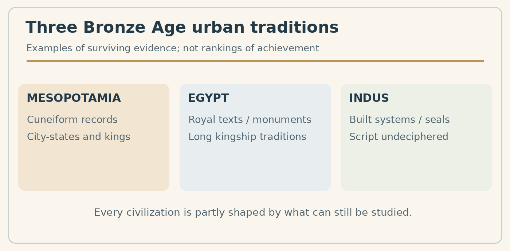

By now you have met Mesopotamia, Egypt and the Indus civilization. Each offers striking examples of Bronze Age urbanism, specialized work, long-distance networks and complex institutions. The temptation is to ask which was 'most advanced.' The question sounds comparative but often conceals an undefined measure: advanced at what, and for whom? Monumental royal tombs, administrative tablets, water engineering, trade networks and apparent social diversity measure different things. An empire that writes many victory inscriptions is easier to describe politically, not automatically more sophisticated than a civilization whose surviving writing cannot be read.

<figure class="figure" id="figure-13-12">

<figcaption>Figure 13.12. Different surviving source types make some questions easier to answer than others. <a class="figure-anchor" href="#figure-13-12" aria-label="Link to this figure">#</a></figcaption>
</figure>

Mesopotamian city-states generated large bodies of administrative and literary texts that have been deciphered. Egypt built durable traditions of territorial kingship and monumental royal presentation. The Indus world developed far-reaching cultural conventions in city design, water management, weights, seals and craft production while leaving political and religious institutions harder to reconstruct. Every comparison carries a source asymmetry: where written records survive, historians can tell stories of named people; where they do not, we must let material patterns do more of the work.

A useful three-part comparison asks: What environmental opportunities and risks did each region face? What evidence identifies systems of coordination? What is the most important limitation in that evidence? For Mesopotamia, written archives may overrepresent officials and temples. For Egypt, elite monuments can overrepresent royal ideals. For the Indus, physical infrastructure often survives without readable self-description. All three require cross-checking against households, burial practices, landscapes and long-term changes.

You should now see why Knowledge Kingdom began with chapters on evidence, statistics and systems before proceeding to early civilizations. Complex societies are not explained by one river, one inventor, one ruler or one disaster. They are historical relationships among people, technologies, environments and institutions—and the evidence for those relationships is uneven.
