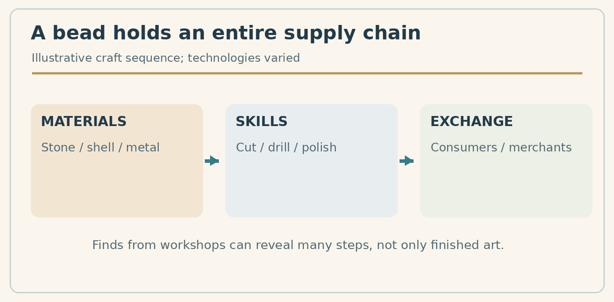

A bead no larger than a fingertip can contain hours of skilled labor and a long history of exchange. Harappan artisans worked with stones such as carnelian and agate, shell, copper and bronze, gold, ceramics and fired materials including faience. Making and drilling hard stone required practiced techniques, appropriate tools, and knowledge of heat and surface finishing. Artifacts and workshop remains at sites such as Harappa and Chanhu-daro show specialized production and networks connecting raw materials to finished goods. \[<a href="/013-the-indus-valley-civilization/sources/#source-10" class="cite">10</a>\]\[<a href="/013-the-indus-valley-civilization/sources/#source-18" class="cite">18</a>\]

What does specialization tell us? When some households or workshops invest time in producing objects for other people, they depend on access to food, fuel and exchange. A craft specialist may be independent, work for an institution, belong to a family tradition, or operate under patronage. Tools alone do not reveal the employment contract. Nevertheless, the evidence points to skills distributed among many people, not a civilization constructed solely by anonymous orders from an imagined palace.

Cotton textiles are an important part of South Asian technological history, even though cloth usually survives poorly in archaeological deposits. Archaeologists infer fiber use from rare material traces, impressions, tools and associated evidence. Perishable goods create a 'survival bias' that can make a prehistoric economy look more dependent on stone, brick and metal than it actually was. The absence of beautiful preserved textiles in a museum case is not proof that people did not weave everyday fabric.

<figure class="figure" id="figure-13-8">

<figcaption>Figure 13.8. A finished bead depends on materials, technique and social exchange. <a class="figure-anchor" href="#figure-13-8" aria-label="Link to this figure">#</a></figcaption>
</figure>

A practical lesson follows. When you admire a bronze tool or decorated seal, ask what lies behind it: knowledge of material properties; a source of raw inputs; tools and fuel; a production sequence; transport; users and repair. A finished object compresses a supply chain. This is why the industrial and commercial themes of later Knowledge Kingdom chapters already have deep roots in archaeology.
