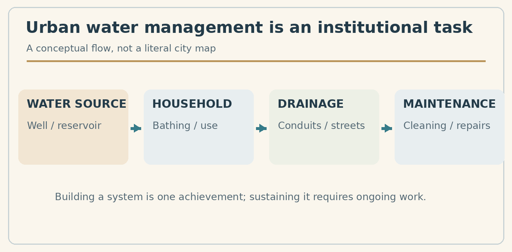

Mohenjo-daro, in Sindh in present-day Pakistan, remains one of the most famous sites. Its substantial brick buildings, streets, wells, bathing platforms and drainage features have made it an enduring image of Indus urbanism. The elevated sector traditionally described as a 'citadel' and the lower-town areas show differentiated spaces, but we should be cautious about transferring the military and political meanings of the word <em>citadel</em> into every building it names. Archaeologists use labels to organize sites, and those labels are sometimes more confident than our knowledge of ancient functions. \[<a href="/013-the-indus-valley-civilization/sources/#source-2" class="cite">2</a>\]\[<a href="/013-the-indus-valley-civilization/sources/#source-11" class="cite">11</a>\]

The Great Bath is one of the most memorable features: a large brick-lined basin built with attention to controlling water. Its scale and construction imply an important collective undertaking. It may have had ceremonial significance, but identifying the ritual, the participants, or the deity involved goes beyond what its physical form alone can establish. 'Likely used for a special collective or ceremonial purpose' is a more defensible statement than claiming to know a complete lost religion. \[<a href="/013-the-indus-valley-civilization/sources/#source-2" class="cite">2</a>\]\[<a href="/013-the-indus-valley-civilization/sources/#source-4" class="cite">4</a>\]

<figure class="figure" id="figure-13-3">

<figcaption>Figure 13.3. A simplified system for water provision, use, drainage and upkeep in an ancient city. <a class="figure-anchor" href="#figure-13-3" aria-label="Link to this figure">#</a></figcaption>
</figure>

The domestic water systems are no less interesting than the celebrated bath. Excavations reveal wells, bathrooms and drains serving multiple households and streets. Wastewater management required design, maintenance and rules governing shared spaces; a beautiful brick drain becomes useless if it is never cleaned. But the existence of extensive drainage does not mean every resident enjoyed identical sanitation or that the city met modern public-health standards. A city can be impressive and unequal, technically inventive and ecologically vulnerable, carefully planned and continually rebuilt. \[<a href="/013-the-indus-valley-civilization/sources/#source-11" class="cite">11</a>\]

There is also a preservation lesson. Mud-brick structures, erosion, salts and changing groundwater complicate what has survived. An excavated quarter is not necessarily representative of every quarter, and the number of wells visible in excavated areas cannot be converted into a precise population figure by a simple ratio. The best historical reconstruction begins with an admiration for the engineering, then asks what has actually been observed and what remains outside the excavated area.
