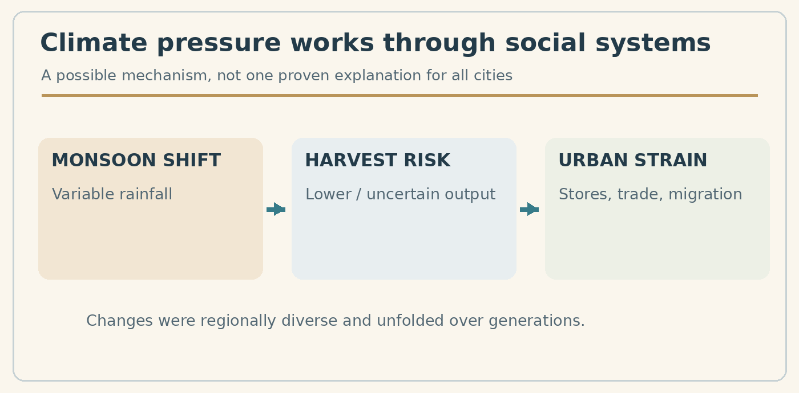

To understand the later Harappan world, start with the fact that the environment is not a static background. The Indus river system carries immense sediment loads; rivers change course, flood with varying intensity and reshape the land. Seasonal monsoon rainfall influences crop opportunities and water supplies differently across the region. Researchers study ancient sediments, landforms, isotopes, archaeological dates and changing site distributions to reconstruct those histories. Each form of evidence answers a different question and has its own limitations. \[<a href="/013-the-indus-valley-civilization/sources/#source-6" class="cite">6</a>\]\[<a href="/013-the-indus-valley-civilization/sources/#source-7" class="cite">7</a>\]\[<a href="/013-the-indus-valley-civilization/sources/#source-20" class="cite">20</a>\]

The case of ancient channels in the Ghaggar-Hakra region is especially instructive. Geological work indicates that the Sutlej River changed course long before the mature Harappan urban phase in parts of the system studied. This means it is hazardous to infer a massive continuously flowing glacier-fed river at the time of the cities simply because a broad abandoned channel exists. Some settlement areas may have relied on seasonal monsoon-fed waterways and accessible groundwater. Geological history and archaeological history need to be matched chronologically, not merely visually. \[<a href="/013-the-indus-valley-civilization/sources/#source-7" class="cite">7</a>\]

<figure class="figure" id="figure-13-10">

<figcaption>Figure 13.10. A proposed pathway from water variability to urban stress, not a single proven cause. <a class="figure-anchor" href="#figure-13-10" aria-label="Link to this figure">#</a></figcaption>
</figure>

Many studies link changing monsoon patterns and water availability to the reorganization of Harappan settlements, but the exact regional timing, strength of effects and interaction with social decisions are debated. A plausible mechanism is that declining or less predictable water reduced the reliability of agricultural surplus in some areas, making large, highly specialized cities more difficult to sustain. Yet one climate curve does not identify who migrated, who stayed, or why particular institutions ceased operating. Climate change shapes options; human communities still make decisions among them. \[<a href="/013-the-indus-valley-civilization/sources/#source-6" class="cite">6</a>\]\[<a href="/013-the-indus-valley-civilization/sources/#source-20" class="cite">20</a>\]

We can use a simplified risk model to see why repeated shocks matter. Assume a town's food reserves normally cover 18 months of modest demand. One poor harvest may be manageable if reserves and external exchange remain available. Three poor harvests within five years, combined with trade interruptions and migration, could exhaust that buffer without one single catastrophic day. The numbers here are invented for teaching, but the logic explains how gradual environmental stress can generate cumulative institutional change.
