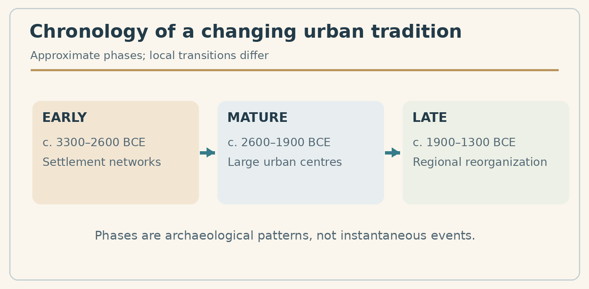

Historians often divide Harappan history into Early, Mature and Late phases. A broad classroom chronology places the Early Harappan period around 3300–2600 BCE, the Mature Harappan urban phase around 2600–1900 BCE, and the Late Harappan period from roughly 1900 to 1300 BCE, while acknowledging that different sites and authors use somewhat different ranges. These phases describe archaeological patterns, not three switches simultaneously flipped across an enormous territory. Some places urbanized earlier, others later, and some remained rural throughout. \[<a href="/013-the-indus-valley-civilization/sources/#source-1" class="cite">1</a>\]\[<a href="/013-the-indus-valley-civilization/sources/#source-5" class="cite">5</a>\]

Long before the mature cities, communities in the wider region were farming, herding, making pottery and taking part in networks of exchange. Mehrgarh, in today's Balochistan, illustrates a much earlier and complex history of settled life and food production, but we should not treat every feature of later Harappan society as an inevitable consequence of that one site's development. The centuries between small early settlements and the great cities involved changing crops, household economies, crafts, settlement size and relationships among communities. \[<a href="/013-the-indus-valley-civilization/sources/#source-5" class="cite">5</a>\]\[<a href="/013-the-indus-valley-civilization/sources/#source-8" class="cite">8</a>\]

At Harappa itself, excavations distinguish pre-urban and increasingly urban phases. Streets, craft areas, mud-brick construction and aspects of administration developed before the most widespread mature style became visible. The crucial lesson is that 'the rise of civilization' means many overlapping experiments by many communities. No single founder had to invent drainage, measurement, urban planning and social coordination on one remarkable morning. \[<a href="/013-the-indus-valley-civilization/sources/#source-9" class="cite">9</a>\]

<figure class="figure" id="figure-13-2">

<figcaption>Figure 13.2. Broad archaeological phases; individual settlements developed and changed at different times. <a class="figure-anchor" href="#figure-13-2" aria-label="Link to this figure">#</a></figcaption>
</figure>

The date around 1900 BCE also needs care. It marks an important transition in the widespread urban network, not a moment when every inhabitant disappeared. The next question is therefore not merely 'Why did the cities fall?' but 'What changed, where, and over how many generations?' That framing will matter when we examine climate and settlement shifts near the end of the chapter.
