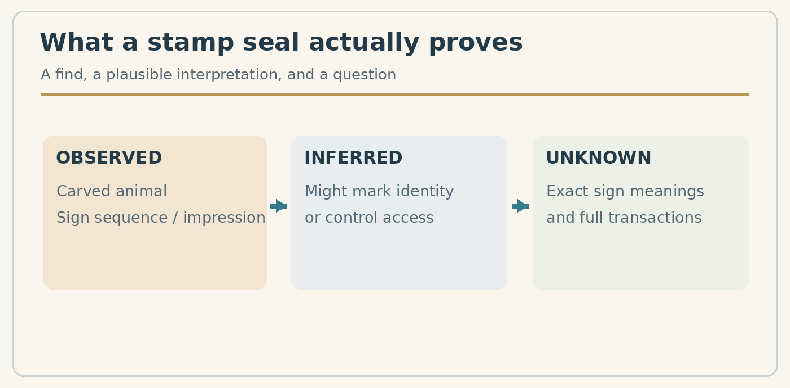

Among the most recognizable Indus artifacts are small, often square seals carved from steatite, a relatively soft stone that can be worked and then treated to become more durable. They commonly show an animal image and several signs. Some depict a creature often called the 'unicorn' because it is represented in profile with what appears to be one projecting horn; that name describes the image, not an identification of a real animal or the meaning of a lost myth. Other seals depict bulls, buffaloes, elephants, rhinoceroses and other figures. Seals and their impressions occur in different archaeological contexts, and some examples have been found beyond the Indus region. \[<a href="/013-the-indus-valley-civilization/sources/#source-3" class="cite">3</a>\]\[<a href="/013-the-indus-valley-civilization/sources/#source-14" class="cite">14</a>\]

Seals can serve practical and symbolic functions. In various ancient societies, a stamp impression could show that a package was closed by an authorized person or institution, or that a commodity was associated with a particular identity. But it would be a leap to claim that every Indus seal was used for exactly one such purpose. Some could mark ownership, membership, office, exchange, religious commitments, or combinations of these. We cannot read the inscriptions to settle the question. \[<a href="/013-the-indus-valley-civilization/sources/#source-3" class="cite">3</a>\]

<figure class="figure" id="figure-13-6">

<figcaption>Figure 13.6. Separate what a seal shows from what historians may infer and cannot yet translate. <a class="figure-anchor" href="#figure-13-6" aria-label="Link to this figure">#</a></figcaption>
</figure>

Imagine finding three seal impressions on clay fragments around the same storeroom, then recovering another example near a craft workshop. Repeated use in secure contexts could begin to support a hypothesis about a system for organizing goods. Yet even then, 'this seal helped administer a shipment' would be a functional inference, not a translation of the signs. To test the hypothesis, researchers would ask where the sealings were found, how the impressions were produced, whether goods or containers were nearby and whether similar patterns occur at other sites. The humble artifact becomes important because it connects visual culture, record-keeping and economic trust.

It is also important not to mistake an attractive object for an explanation of a whole society. A photographed 'unicorn' seal may travel through online debates over religion or ethnicity, but its meaning depends on where it was found and the larger set of comparable finds. Without a context, a reader can easily build a story out of one striking image and overlook hundreds of quieter objects.
