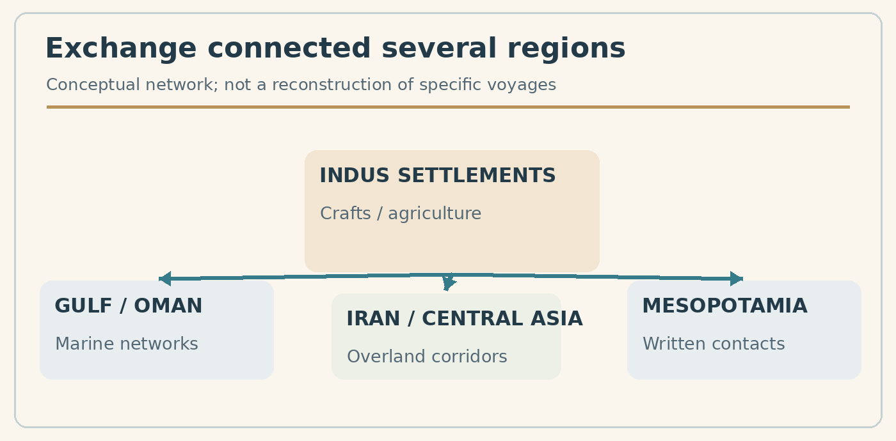

Indus settlements were linked to distant networks. Archaeological evidence includes materials whose sources lie far from the cities, artifacts found outside the region, and shared forms that suggest sustained contact. South Asian goods and designs interacted with communities in the Iranian plateau, Afghanistan, Oman, the Gulf and Mesopotamia. Mesopotamian texts mention a distant place called <em>Meluhha</em>, commonly but not without interpretive questions associated with the Indus cultural sphere. \[<a href="/013-the-indus-valley-civilization/sources/#source-4" class="cite">4</a>\]\[<a href="/013-the-indus-valley-civilization/sources/#source-14" class="cite">14</a>\]\[<a href="/013-the-indus-valley-civilization/sources/#source-19" class="cite">19</a>\]

A Bronze Age maritime route was not an ancient version of today's global container fleet. Sailors navigated changing coastal waters, seasonal winds and ports with different capacities; goods passed through intermediaries, and one object could change hands many times before arriving in a city. Coastal and inland settlements connected marine routes to agricultural and craft-producing hinterlands. Calling an object 'imported' may describe its material source, the region where it was manufactured, or the last trading partner; these are not always identical.

<figure class="figure" id="figure-13-9">

<figcaption>Figure 13.9. Overland and seaborne exchange linked regions; arrows show relationships, not exact routes. <a class="figure-anchor" href="#figure-13-9" aria-label="Link to this figure">#</a></figcaption>
</figure>

Mesopotamian records are precious because they are readable, but they are not neutral witnesses to the entire Indus economy. They illuminate what a Mesopotamian writer or administrator chose to record and the place names used in that scribal tradition. They do not tell us what an Indus merchant thought of an Akkadian ruler, whether a shipment was a gift or a commercial contract in the modern sense, or how every exchange was regulated in a Harappan city. We need both the texts and archaeological evidence to make the comparison useful.

Trade connects to political resilience. A settlement with access to imported stones or metals may depend on long routes it cannot control. Interruptions could threaten prestigious crafts, but the loss of an overseas partner would not necessarily stop basic grain production. The effect depends on which goods, workers and institutions relied on the exchange. This is a systems-thinking problem, not a one-cause explanation for political change.
