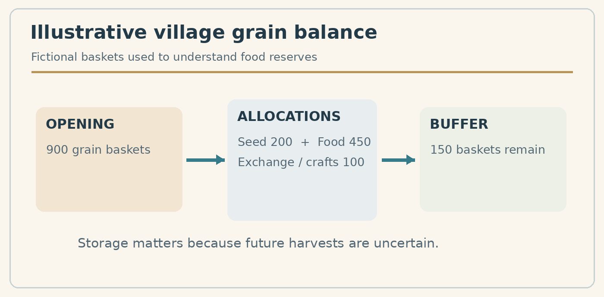

The cities did not eat bricks. They depended on harvests, herds, fuel and agricultural labor from surrounding settlements. Farmers grew crops including wheat and barley in many regions, and other crops—among them pulses, oilseeds, millets and rice in some places and periods—contributed to regional diversity. Cotton is particularly associated with early South Asian textile traditions, although individual claims about exact priority or the size of production need careful dating and context. Cattle, sheep, goats and other animals supported different combinations of food production, transport and work. \[<a href="/013-the-indus-valley-civilization/sources/#source-5" class="cite">5</a>\]\[<a href="/013-the-indus-valley-civilization/sources/#source-8" class="cite">8</a>\]

These patterns varied across the enormous region. Flood-recession farming could be useful where rivers deposited fertile sediment and moisture. In drier or monsoon-influenced areas, crop choices and planting calendars differed. There is no reason to imagine that every Harappan village followed one official agricultural manual. The practical problems were familiar in different forms: seed had to be saved, food had to reach settlements, and households had to survive seasonal and multi-year uncertainty.

Consider a purely hypothetical accounting example. A village stores 900 baskets of barley. It reserves 200 for seed, 450 for local households and 100 for craft workers and exchange; 150 remain as a buffer before losses. If a drought cuts the next harvest in half, that buffer may become crucial. We cannot use this invented example to estimate an actual Harappan tax. We can, however, use it to understand why storage, trust, transport, and arrangements for allocating scarce food matter to every large settlement.

<figure class="figure" id="figure-13-4">

<figcaption>Figure 13.4. Illustrative grain allocation; the quantities are fictional and are not an excavated account. <a class="figure-anchor" href="#figure-13-4" aria-label="Link to this figure">#</a></figcaption>
</figure>

A rural household's choices could also constrain urban life. Farmers might prefer flexible local exchanges while urban administrators sought standardized deliveries; pastoral mobility might not fit neat town boundaries; weather could frustrate agreed obligations. The growth of cities required interdependence, not merely the imposition of a straight-line plan upon passive countryside.
