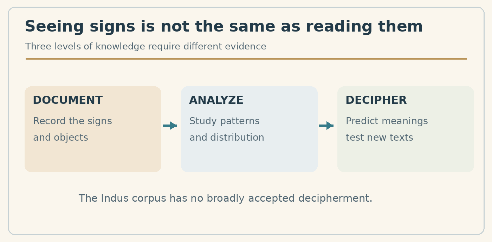

The Indus signs appear on seals, tablets, pottery and other objects. Most inscriptions are short, and no widely accepted bilingual text equivalent to the Rosetta Stone has been discovered. Researchers debate not just how to assign sounds or meanings to individual signs, but whether the entire system functioned like a fully developed writing system for a particular language or something more restricted, such as a complex nonlinguistic sign system. Many specialists regard it as a script, but proposed decipherments and language assignments have not achieved broad scholarly acceptance. \[<a href="/013-the-indus-valley-civilization/sources/#source-3" class="cite">3</a>\]\[<a href="/013-the-indus-valley-civilization/sources/#source-4" class="cite">4</a>\]\[<a href="/013-the-indus-valley-civilization/sources/#source-15" class="cite">15</a>\]

We should distinguish three levels of knowledge. First, the marks themselves exist: they can be photographed, classified and compared. Second, researchers can analyze regularities in how signs occur and on which kinds of objects they appear. Third, proposing the <em>meaning</em> or <em>sound</em> of those signs requires much stronger evidence. A sequence recurring at the end of inscriptions could be an administrative marker, a name element, a grammatical ending or something else. Statistical patterns help narrow hypotheses, but pattern-finding does not produce a securely translated sentence by itself.

<figure class="figure" id="figure-13-7">

<figcaption>Figure 13.7. Three different tasks: recording signs, studying patterns and producing a tested decipherment. <a class="figure-anchor" href="#figure-13-7" aria-label="Link to this figure">#</a></figcaption>
</figure>

The problem is unusually resistant because inscriptions tend to be brief, archaeological contexts vary, and the underlying language is uncertain. Scholars have proposed different language families and cultural connections, including Dravidian-related interpretations, but no reading has passed the combination of independent testing, broad inscription coverage and scholarly agreement that made ancient Egyptian or cuneiform decipherment persuasive. Be especially suspicious of online claims that a whole corpus was 'finally solved' by finding a few familiar-looking shapes.

An undeciphered script can still reveal history. Its sign forms and distribution show repeated visual conventions across distances. Seals and tablets reveal institutions concerned with identity, signaling or administration. They also tell us something about the limits of our evidence: we should not write a political or religious history as if we possessed statements that we cannot read. This is one of the clearest demonstrations in Knowledge Kingdom of intellectual humility as a positive historical skill.
