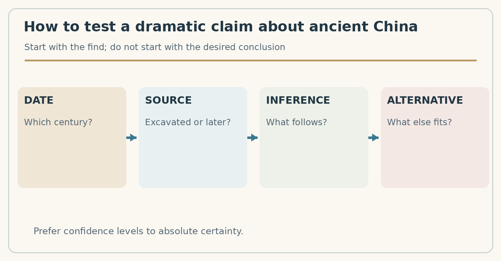

Use this short method whenever you encounter a striking claim about an ancient dynasty. Start by writing the claim in one sentence with a place and date. List the actual sources, distinguishing excavated objects from later texts. Identify the strongest contemporary evidence, if any. Describe at least one alternative interpretation, not merely an alternative story. Ask what new find could change your confidence—a dated inscription naming a ruler, a sealed excavation layer, or a larger sample of ordinary households. Then state your conclusion with calibrated language: <em>demonstrates</em>, <em>supports</em>, <em>suggests</em> or <em>remains uncertain</em>.

A useful final test is to identify where modern political identities have slipped into ancient descriptions. Modern maps are necessary, but the territory of the People's Republic of China in the present day is not the same thing as the Shang kingdom in the late second millennium BCE. Similarly, the survival of Chinese characters through many historical transformations is not proof that every later political regime inherited an unchanged culture. Historical continuity becomes more interesting when we can explain <strong>how</strong> it endured despite change, not when we pretend change never happened.

<figure class="figure" id="figure-14-12">

<figcaption>Figure 14.12. A claim about antiquity should be tested against its date, source type and alternative interpretations. <a class="figure-anchor" href="#figure-14-12" aria-label="Link to this figure">#</a></figcaption>
</figure>
