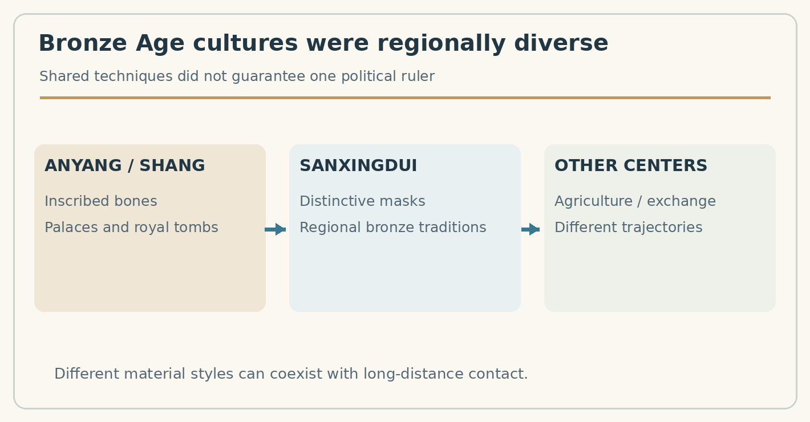

If our investigation stopped at Anyang, early China would seem almost entirely a Shang story. Discoveries at <strong>Sanxingdui</strong> in today's Sichuan province make that approach inadequate. Bronze heads and masks, human figures, jade and gold objects reveal extraordinary artistic and ceremonial traditions in a region contemporaneous with the Shang. Some forms are unlike those of the central plains, even while evidence also points to connections through wider networks of exchange and knowledge. \[<a href="/014-ancient-china-dynasties-and-statecraft/sources/#source-5" class="cite">5</a>\]\[<a href="/014-ancient-china-dynasties-and-statecraft/sources/#source-17" class="cite">17</a>\]

These objects do not supply a written history of named Sanxingdui kings. Archaeologists continue to examine deposits, production techniques, dates and relations with other regional centers. That is a reason to avoid fantasies of an isolated 'lost empire' or a civilization unrelated to anyone else. Distinctiveness and contact can coexist. The variety of material cultures is exactly what a large region with many political communities should lead us to expect.

<figure class="figure" id="figure-14-7">

<figcaption>Figure 14.7. Anyang and Sanxingdui reveal multiple Bronze Age traditions and interconnected regional histories. <a class="figure-anchor" href="#figure-14-7" aria-label="Link to this figure">#</a></figcaption>
</figure>

The Sanxingdui case also shows how museums influence historical imagination. A striking mask may attract far more attention than ordinary pottery, agricultural tools or household remains. If we study only the spectacular pieces, we risk confusing elite ritual display with the complete life of a society. A fuller reconstruction needs excavated houses, environmental evidence, craft workshops, subsistence studies and regional surveys. The historian's task is not to choose between artistic wonder and sober investigation but to use each to illuminate the other.
