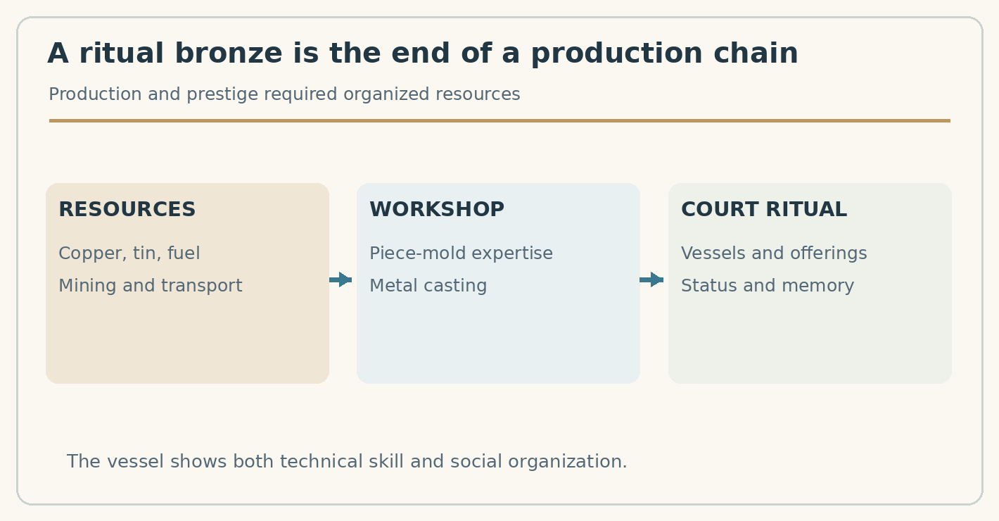

Bronze is usually an alloy of copper and tin, sometimes containing other metals. The Shang and Zhou worlds produced weapons, tools and especially impressive ritual vessels. Creating a large decorated vessel required metal sources, fuel, ceramic molds, specialist casting skills and coordinated labor. A finished vessel was thus also a visible claim about access to networks of resources and people. \[<a href="/014-ancient-china-dynasties-and-statecraft/sources/#source-11" class="cite">11</a>\]\[<a href="/014-ancient-china-dynasties-and-statecraft/sources/#source-14" class="cite">14</a>\]

Early Chinese bronze-casting specialists developed highly sophisticated <strong>piece-mold casting</strong> methods, in which decorated clay mold sections and cores enabled complex vessel shapes. The method was distinctive in its prominence; it is misleading to say no other civilization ever cast bronze or that all Chinese bronzes were made identically. Workshops refined the relationship between vessel shape, decorative relief and the technological sequence of molding and casting. \[<a href="/014-ancient-china-dynasties-and-statecraft/sources/#source-11" class="cite">11</a>\]

<figure class="figure" id="figure-14-5">

<figcaption>Figure 14.5. Finished bronze vessels depended on resources, techniques, social organization and elite patronage. <a class="figure-anchor" href="#figure-14-5" aria-label="Link to this figure">#</a></figcaption>
</figure>

Consider an enormous <em>ding</em> vessel. It could be used in ritual contexts associated with food offerings and elite status. An observer might admire its artistry, but an economic historian asks further questions: who mined copper, who transported ore, who fed the casters, who decided the form, and who was permitted to commission the object? The visible bronze is the output of an invisible social system. We should also avoid assuming that every bronze was a straightforward indicator of a single rank at every time; conventions and meanings changed.
