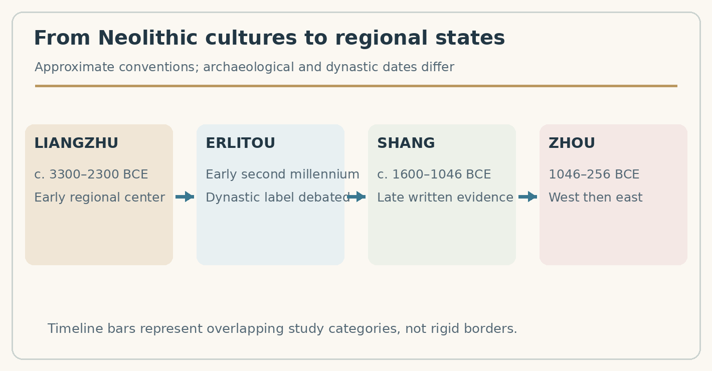

A textbook often presents three early ruling houses in sequence: <strong>Xia, Shang, Zhou</strong>. In traditional Chinese historical writing, the Xia dynasty precedes the Shang. Later sources tell stories of flood control, exemplary rulers and dynastic succession. These are important cultural memories. But they were written down much later than the period they describe, and historians must not treat the tradition as proof that every named ruler or date can be independently verified. \[<a href="/014-ancient-china-dynasties-and-statecraft/sources/#source-9" class="cite">9</a>\]\[<a href="/014-ancient-china-dynasties-and-statecraft/sources/#source-10" class="cite">10</a>\]

Archaeology has revealed increasingly complex Bronze Age settlements in the middle Yellow River region. The site of Erlitou, in present-day Henan, is often discussed in relation to the Xia tradition. It has substantial buildings, elite materials and evidence of craft production; estimates commonly place its flourishing in the early second millennium BCE. <strong>An archaeological settlement and a later textual dynasty are not automatically identical.</strong> There is no generally accepted contemporary inscription from Erlitou conclusively naming its rulers as Xia kings. \[<a href="/014-ancient-china-dynasties-and-statecraft/sources/#source-9" class="cite">9</a>\]\[<a href="/014-ancient-china-dynasties-and-statecraft/sources/#source-10" class="cite">10</a>\]

The Shang, by contrast, can be studied with a rare combination of excavated sites and contemporary royal inscriptions from its later phase. The conventional dynastic dates are approximately <strong>1600–1046 BCE</strong>, but the precision of early phases is debated; our clearest written window comes from the late Shang at Anyang, especially from around the thirteenth century BCE. The Zhou defeated the Shang around <strong>1046 BCE</strong>, according to a widely used chronological convention. The Western Zhou period is usually dated <strong>1046–771 BCE</strong>, with the Eastern Zhou period following from around <strong>770 BCE</strong> until the Zhou royal line ended in <strong>256 BCE</strong>. The later Qin unification in 221 BCE belongs to the next great transformation, not to a timeless 'ancient China'. \[<a href="/014-ancient-china-dynasties-and-statecraft/sources/#source-1" class="cite">1</a>\]\[<a href="/014-ancient-china-dynasties-and-statecraft/sources/#source-9" class="cite">9</a>\]\[<a href="/014-ancient-china-dynasties-and-statecraft/sources/#source-11" class="cite">11</a>\]

<figure class="figure" id="figure-14-3">

<figcaption>Figure 14.3. Approximate chronological guide; archaeological cultures and later dynastic labels are not identical categories. <a class="figure-anchor" href="#figure-14-3" aria-label="Link to this figure">#</a></figcaption>
</figure>

Remember what these labels do: they organize complicated evidence. A dynastic name can describe a royal lineage, cultural network, ideological claim and later historian's chronology at once. The borders and power of a ruling house were rarely identical throughout its lifespan. The precise date of a battle can be less important than understanding which kinds of evidence establish the sequence.
