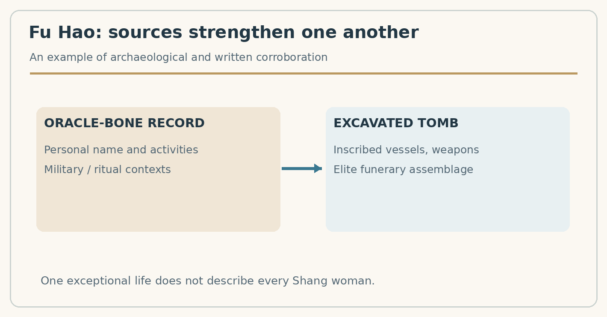

One exceptional late Shang woman appears in both inscriptions and archaeology: <strong>Fu Hao</strong>, associated with King Wu Ding. Oracle-bone texts connect her with military activity and ritual responsibilities, while a largely intact tomb excavated at Anyang in 1976 contained a rich assemblage of bronzes, jades, weapons, ornaments and other objects. The cross-check between named inscriptions and burial evidence is especially valuable. \[<a href="/014-ancient-china-dynasties-and-statecraft/sources/#source-15" class="cite">15</a>\]\[<a href="/014-ancient-china-dynasties-and-statecraft/sources/#source-16" class="cite">16</a>\]

Fu Hao's case does not justify concluding that women and men held equal authority across Shang society. It establishes something more precise and more informative: at least one prominent royal woman occupied major political, military and ceremonial roles, and some elite women could command considerable resources. Other women lived very different lives, most of which are harder to recover from surviving sources. We should resist both extremes: imagining an entirely powerless female population and imagining an equal society on the strength of one famous tomb.

<figure class="figure" id="figure-14-6">

<figcaption>Figure 14.6. The tomb of Fu Hao and written records provide complementary—but not universal—evidence of women’s roles. <a class="figure-anchor" href="#figure-14-6" aria-label="Link to this figure">#</a></figcaption>
</figure>

The tomb is also a lesson in evidence. Weapons may support an interpretation of military standing; inscriptions give particular context; associated grave goods show elite access to craft and exchange. Yet tomb deposits reflect funerary choices as well as activities performed in life. The safest conclusion combines different kinds of evidence and avoids treating each object as the exact equivalent of a modern résumé. The discovery of Fu Hao's tomb shows how one well-documented site can challenge a simplistic narrative.
