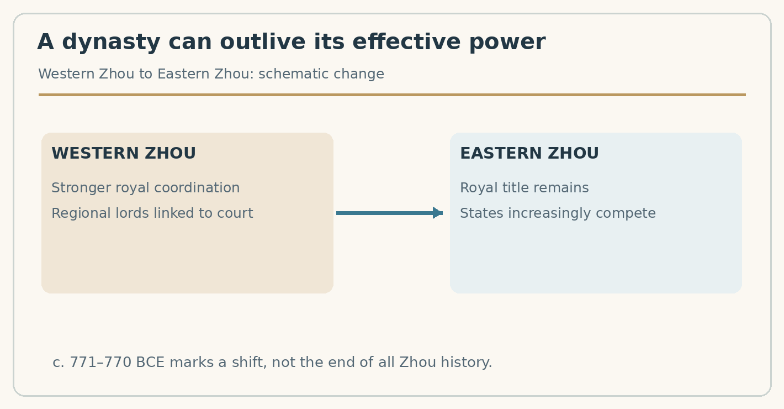

By the late Western Zhou, the balance between royal authority and regional powers had become strained. Accounts of conflict and pressure from neighboring groups surround the crisis that ended Western Zhou rule in <strong>771 BCE</strong>. The court relocated eastward, and the period conventionally beginning around <strong>770 BCE</strong> is known as the Eastern Zhou. Historians should be cautious about treating every dramatic episode in later narratives as a precisely documented cause. The long-term erosion of effective royal control matters more than any single colorful anecdote. \[<a href="/014-ancient-china-dynasties-and-statecraft/sources/#source-11" class="cite">11</a>\]\[<a href="/014-ancient-china-dynasties-and-statecraft/sources/#source-18" class="cite">18</a>\]

Under the Eastern Zhou, the Zhou king retained symbolic significance while many regional states exercised increasingly independent power. Competition between courts encouraged military and administrative innovation. Alliances shifted, rival rulers sought advantage, and institutions adapted. Some of these developments resemble themes we know from other histories: competition among Mesopotamian city-states or the balance between an empire's center and frontier leaders. But the detailed institutions were different, and we should compare mechanisms, not assume identical stories.

<figure class="figure" id="figure-14-10">

<figcaption>Figure 14.10. A royal title can outlive practical authority as states compete and political institutions change. <a class="figure-anchor" href="#figure-14-10" aria-label="Link to this figure">#</a></figcaption>
</figure>

Eastern Zhou is commonly divided into the <strong>Spring and Autumn</strong> and <strong>Warring States</strong> periods. Period boundaries vary somewhat between scholarly conventions; the Warring States era is often dated from the fifth century BCE to Qin unification in 221 BCE. That later contest will be central when we return to ancient China in subsequent chapters. Here, the purpose is to see how a dynasty can survive as a title while much of its practical authority disperses. The difference between <strong>formal legitimacy and effective power</strong> is one of the most durable lessons of world history.
