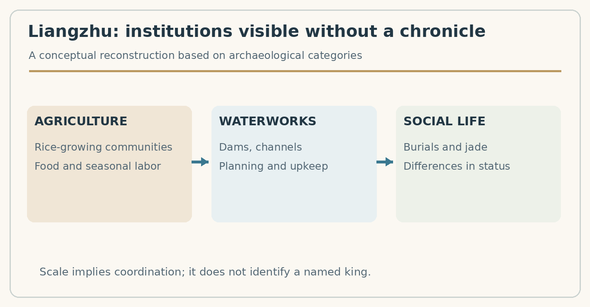

In the lower Yangtze region, the Liangzhu culture flourished approximately <strong>3300–2300 BCE</strong>. Around its major center, archaeologists have documented substantial earthworks, water-management structures, elaborate jade objects and cemeteries whose differences suggest social ranking. The extensive water-conservancy system and settlement planning required the coordination of labor, materials and engineering knowledge. UNESCO recognizes the archaeological ruins as evidence of an early regional political center based on rice agriculture. \[<a href="/014-ancient-china-dynasties-and-statecraft/sources/#source-7" class="cite">7</a>\]\[<a href="/014-ancient-china-dynasties-and-statecraft/sources/#source-8" class="cite">8</a>\]

The word <em>state</em> here is a reasoned archaeological interpretation, not a transcript of an ancient constitution. We cannot read a Liangzhu royal chronicle that names rulers and ministers. Instead we infer institutional complexity from construction scale, changing settlements, burials and repeated symbols. Claims of a 'unified belief system' describe patterns in the material record, not a complete theological manual. The temptation to label every elaborate jade object as the badge of a specific modern office should be resisted. \[<a href="/014-ancient-china-dynasties-and-statecraft/sources/#source-7" class="cite">7</a>\]\[<a href="/014-ancient-china-dynasties-and-statecraft/sources/#source-8" class="cite">8</a>\]

Imagine what coordinating an earthen dam requires. Food must sustain workers, specialists must understand where water flows, and laborers must gather at the right place at the right season. Someone can enforce a decision; others must cooperate, negotiate or accept obligations. This shows the value of Chapter 7's systems thinking: even without readable legal texts, infrastructure reveals interdependence. It does <strong>not</strong> automatically prove the same political structure later associated with the Shang or Zhou.

<figure class="figure" id="figure-14-2">

<figcaption>Figure 14.2. Water systems, farming and differentiated burials provide evidence of collective organization at Liangzhu. <a class="figure-anchor" href="#figure-14-2" aria-label="Link to this figure">#</a></figcaption>
</figure>

The Liangzhu story matters because it prevents a Yellow-River-only origin myth. The rise of complex society in ancient eastern Asia was <strong>regional and plural</strong>. Different centers grew, adapted and sometimes declined. Some cultural and technical traditions entered later societies; others followed distinct histories. The record is one of experimentation, contact and discontinuity as well as continuity.
