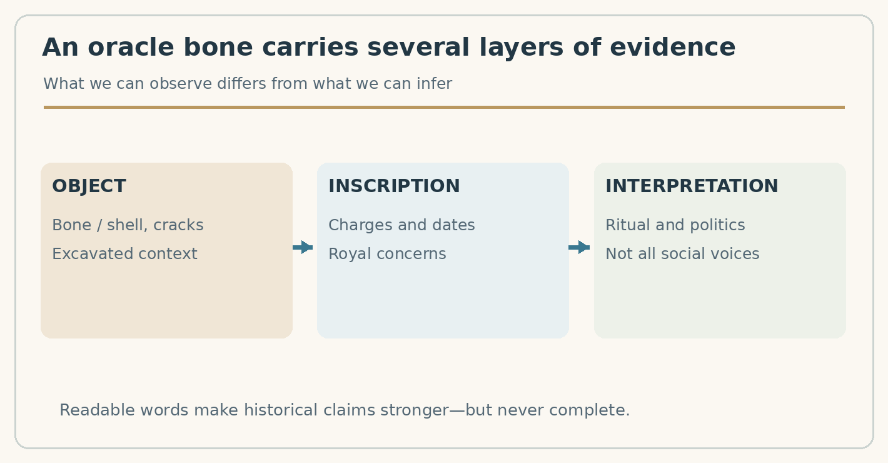

An oracle-bone inscription often belongs to a procedure sometimes called <em>pyro-osteomancy</em>: a prepared animal bone or turtle plastron was heated so that cracks appeared and were interpreted. An inscription could record the proposition or charge, who conducted the divination and, in some cases, a prognostication or subsequent verification. Not every bone carries the same complete formula. The forms changed over the late Shang period, and not every mark is a sentence scholars can confidently translate. \[<a href="/014-ancient-china-dynasties-and-statecraft/sources/#source-2" class="cite">2</a>\]\[<a href="/014-ancient-china-dynasties-and-statecraft/sources/#source-3" class="cite">3</a>\]\[<a href="/014-ancient-china-dynasties-and-statecraft/sources/#source-12" class="cite">12</a>\]

The questions frequently concern what rulers needed to know or influence: rain, harvests, military campaigns, illness, hunting, childbirth and offerings. Modern readers may separate religion from administration, but the Shang court did not operate with our contemporary distinction. Divination belonged to decisions with economic and military consequences, just as ancestral relationships belonged to claims about legitimacy. The inscriptions offer information about calendrical systems, personal names, ritual schedules and political concerns. \[<a href="/014-ancient-china-dynasties-and-statecraft/sources/#source-2" class="cite">2</a>\]

<figure class="figure" id="figure-14-4">

<figcaption>Figure 14.4. A material find becomes evidence of court practice through inscriptions, contexts and careful interpretation. <a class="figure-anchor" href="#figure-14-4" aria-label="Link to this figure">#</a></figcaption>
</figure>

The extraordinary continuity of Chinese writing must be described accurately. Late Shang inscriptions are among the <strong>earliest extensive, securely recognized evidence</strong> of Chinese writing, but that does not demonstrate that every modern character can be traced to one particular bone or that the spoken language was identical to modern Mandarin. Writing changed through bronze inscriptions, regional scripts, later standardizations and many subsequent centuries. Nor do mysterious marks on much earlier pottery automatically prove a complete, deciphered written language. \[<a href="/014-ancient-china-dynasties-and-statecraft/sources/#source-3" class="cite">3</a>\]\[<a href="/014-ancient-china-dynasties-and-statecraft/sources/#source-13" class="cite">13</a>\]
