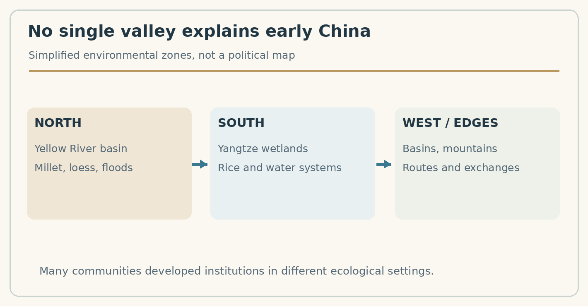

China's vast modern outline can mislead us about its ancient past. The first villages and political centers did not develop inside one unified country. The Yellow River (Huang He) and its tributaries helped support communities across parts of northern China. Farther south, the Yangtze (Chang Jiang) basin and its wetlands sustained different agricultural traditions. Mountains, basins, plateaus, steppe routes and coastlines encouraged movement in some directions and made it harder in others. The Sichuan Basin and the lower Yangtze were not merely distant copies of the middle Yellow River. \[<a href="/014-ancient-china-dynasties-and-statecraft/sources/#source-4" class="cite">4</a>\]\[<a href="/014-ancient-china-dynasties-and-statecraft/sources/#source-5" class="cite">5</a>\]

The Yellow River carries enormous quantities of sediment from landscapes that include the loess plateau. Its changing channels and floods could be productive and destructive. The Yangtze system occupies another ecological world with extensive rainfall and wetland environments. Neither should be described as a perfect duplicate of the Nile, whose flood pattern shaped Egypt in distinctive ways. Water matters, but no river writes a dynasty's history in advance. Flood-control labor, competition for land, seasonal weather, production choices and warfare all depended on human institutions. \[<a href="/014-ancient-china-dynasties-and-statecraft/sources/#source-4" class="cite">4</a>\]

The word 'China' is useful as a modern geographical convenience in a survey like this; it should not imply that Neolithic farmers from every region regarded themselves as members of one nation. Political identities, languages and borders changed over millennia. China's long historical continuity is real in important cultural and institutional respects, but <strong>continuity is not the same as an unbroken, unchanged state</strong>. In this chapter, 'early China' means overlapping archaeological and historical worlds in territory that now forms parts of the People's Republic of China, not an assumption of ancient uniformity.

<figure class="figure" id="figure-14-1">

<figcaption>Figure 14.1. Different river basins and ecological regions created many pathways to early complex societies; not a political map. <a class="figure-anchor" href="#figure-14-1" aria-label="Link to this figure">#</a></figcaption>
</figure>
