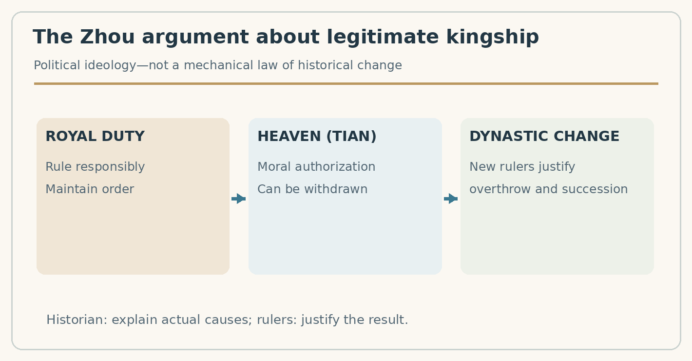

The Zhou justified their victory by claiming that <strong>Heaven (Tian)</strong> had withdrawn favor from the Shang and entrusted rule to the Zhou. In later formulations, a ruler who behaved badly, neglected responsibility or allowed disorder could lose this sanction. The crucial conceptual move was that rightful power did not have to belong eternally to one family: legitimacy could be explained as conditional on how a dynasty ruled. The idea appears in early Zhou ideology but developed through later texts and debates, so modern textbook slogans should not be mistaken for a single verbatim proclamation by every Zhou king. \[<a href="/014-ancient-china-dynasties-and-statecraft/sources/#source-18" class="cite">18</a>\]\[<a href="/014-ancient-china-dynasties-and-statecraft/sources/#source-19" class="cite">19</a>\]

<figure class="figure" id="figure-14-8">

<figcaption>Figure 14.8. The Zhou Mandate of Heaven explains a political legitimacy claim, not a proven mechanism of dynastic change. <a class="figure-anchor" href="#figure-14-8" aria-label="Link to this figure">#</a></figcaption>
</figure>

This was a powerful answer to the conquest problem. It also created a reusable political argument. Successful rebels or new dynasties could say that a fallen house had lost Heaven's favor. Such claims had moral content, but they could also be self-serving: military victory does not itself establish that a conqueror acted justly. Historians must distinguish <em>what rulers claimed</em> from <em>what actually caused a regime to fall</em>. Drought, corruption, battlefield defeats and political disloyalty are concrete processes; the Mandate of Heaven was a framework for giving those events cosmic and moral meaning.

The distinction is important today. To say the Mandate provided a language for criticizing rulers is not to say the Zhou established a modern democracy. People did not acquire an ordinary periodic vote for kingship. Nor should we treat the idea as a simple religious superstition with no institutional effect. Ideologies can alter the incentives and expectations of elites and communities; rulers who claim moral legitimacy invite moral assessment, even if powerful people decide who can speak and be heard.
