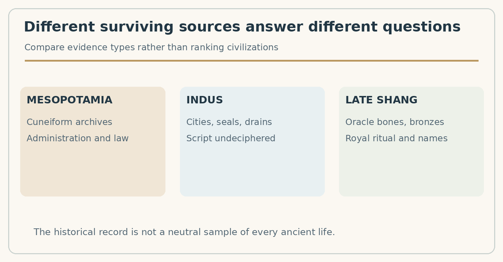

Compare the Indus cities, Mesopotamia and early China without forcing them into a ranking. In Mesopotamia, extensive administrative tablets and literature survive from various periods. In the Indus world, standardized urban material culture is visible, but its signs have no generally accepted decipherment. For late Shang China, readable inscriptions provide an unusually direct window into royal ritual, genealogy and decision-making; archaeology gives that window a physical setting. Different evidence types make different questions answerable. \[<a href="/014-ancient-china-dynasties-and-statecraft/sources/#source-2" class="cite">2</a>\]\[<a href="/014-ancient-china-dynasties-and-statecraft/sources/#source-3" class="cite">3</a>\]\[<a href="/014-ancient-china-dynasties-and-statecraft/sources/#source-11" class="cite">11</a>\]

A cuneiform account of barley distribution might reveal numerical obligations. An Indus drainage system may reveal maintenance and engineering even while its administration remains obscure. A Shang oracle bone may reveal that a king worried about a harvest, but not the total size of production. These cases show why it is dangerous to assert that a society was 'more advanced' solely because one kind of surviving object is spectacular or one archive is easier to read. The quality of a historical claim depends on the match between question and evidence.

<figure class="figure" id="figure-14-11">

<figcaption>Figure 14.11. The source base differs for Mesopotamia, the Indus civilization and late Shang China. <a class="figure-anchor" href="#figure-14-11" aria-label="Link to this figure">#</a></figcaption>
</figure>

They also show convergent problems: how to organize agricultural resources, manage distant communities, give authority a persuasive form, create durable symbols and keep institutions functioning across generations. The answers varied. Comparative history is strongest when it describes similarities as testable patterns and differences as historically significant, rather than reducing all ancient societies to one predictable road toward modern states.
