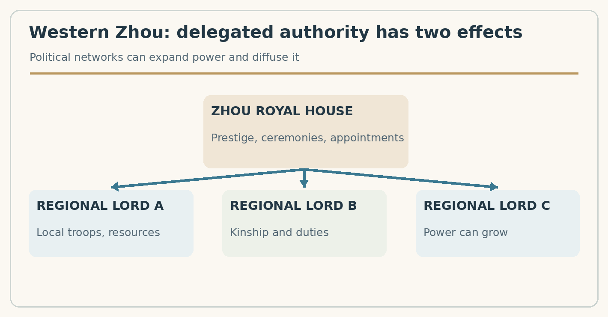

During the <strong>Western Zhou</strong> period, the ruling house exercised a degree of authority over a network of regional centers. The power of relatives and allied aristocratic lineages was essential to the system. Local elites could command land and people while acknowledging the Zhou king's ritual and political standing. Yet over distance, royal authority depended on relationships that could weaken, change or become contested. \[<a href="/014-ancient-china-dynasties-and-statecraft/sources/#source-11" class="cite">11</a>\]\[<a href="/014-ancient-china-dynasties-and-statecraft/sources/#source-18" class="cite">18</a>\]

Bronze vessels from Zhou contexts sometimes carry inscriptions that commemorate appointments, grants, achievements or ancestors. They are precious because they document how an elite wanted an event remembered. Unlike late Shang oracle-bone inscriptions, some Zhou bronze texts are longer records of honor and lineage. But we must still ask who commissioned the inscription, what audience it served, and which conflicts it omitted. A declaration of royal favor is evidence that someone wished to record a connection to the king; its claims should not be treated as a complete census of political obedience. \[<a href="/014-ancient-china-dynasties-and-statecraft/sources/#source-18" class="cite">18</a>\]\[<a href="/014-ancient-china-dynasties-and-statecraft/sources/#source-20" class="cite">20</a>\]

<figure class="figure" id="figure-14-9">

<figcaption>Figure 14.9. Regional delegation extended Zhou authority while creating powerful lineages with their own interests. <a class="figure-anchor" href="#figure-14-9" aria-label="Link to this figure">#</a></figcaption>
</figure>

The Zhou system illustrates a recurring problem of governing territory: delegation creates both reach and vulnerability. When a king entrusts a regional lord with military and economic resources, the lord may defend the royal order—or gain the ability to defy it. Marriage, ceremony, gift-giving and shared ancestral stories can help sustain loyalty, but they cannot remove conflicts of interest. Chapter 7 called this a system with feedback: powerful regional lords help the center project power, and their growth can also make the center less necessary.
