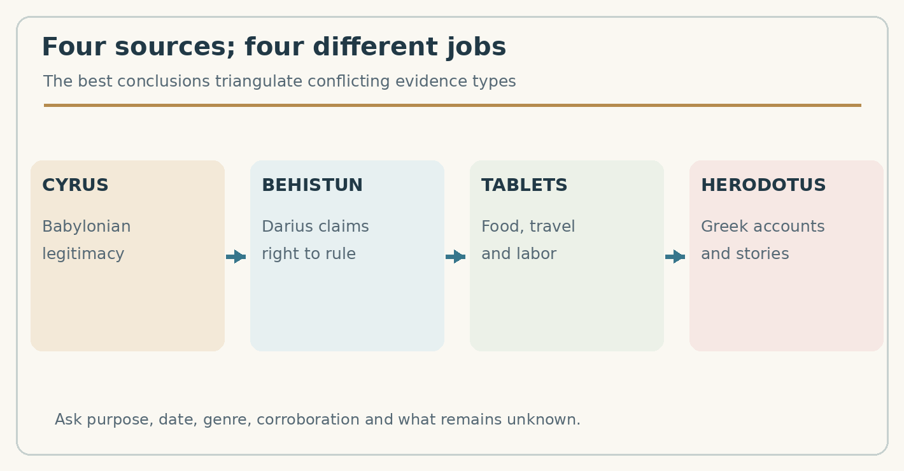

To study Persian government, place four sources on an imaginary table. First is the <strong>Cyrus Cylinder</strong>, a Babylonian text justifying the new conqueror in traditional royal language. Second is <strong>Behistun</strong>, a monumental account by Darius of contested succession and rebellion. Third is a <strong>Persepolis ration tablet</strong>, a small record of administrative distribution. Fourth is <strong>Herodotus</strong>, a Greek author with extensive interest in Persia, local traditions and the conflict between Persia and the Greek cities. The four sources disagree not only because people disagree, but because each was made to do a different job.

Start with genre. A royal monument publicly claims legitimacy. A ration text records a particular transaction or allocation. A Greek narrative organizes stories for readers and listeners, sometimes many years after an event. Next ask about scale. The Cylinder concerns the conquest of Babylon and the royal image constructed around it. Behistun concerns Darius's accession and victories. A single tablet concerns a tiny part of economic activity. Herodotus ranges across events but does not observe all of them directly. Then examine what is missing: the reactions of all ordinary Babylonian households, each individual rebel's account, the personal life of a worker named in a tablet, and Persian royal documents for every war.

Finally, develop a claim that can survive contact with all four sources: 'Achaemenid kings used local institutions and administrative resources while constructing strong claims of royal legitimacy; in some regions their authority was violently contested.' That is modest enough to be supported and substantial enough to matter. It is a better starting point than 'Cyrus invented human rights' or 'Persia was just an army of slaves.' High-quality historical writing often replaces a dramatic but impossible claim with a layered, testable explanation.

<figure class="figure" id="figure-15-12">

<figcaption>Figure 15.12. Triangulating royal claims, administrative records and Greek texts produces more reliable conclusions. <a class="figure-anchor" href="#figure-15-12" aria-label="Link to this figure">#</a></figcaption>
</figure>
