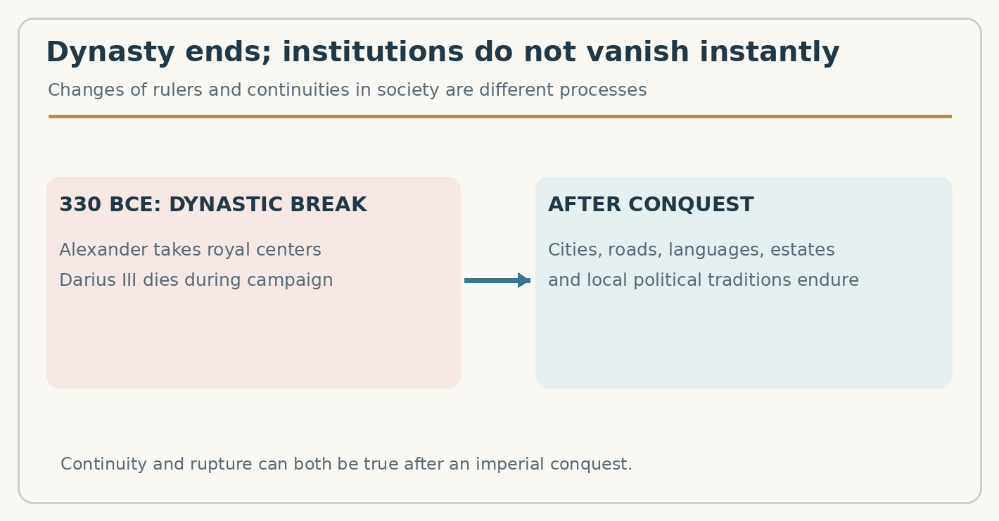

In 334 BCE Alexander III of Macedon crossed into Asia and began a campaign against the Achaemenid monarchy. His forces won major battles, including Issus in 333 and Gaugamela in 331 BCE, against armies associated with Darius III. Alexander's advance carried him through key imperial centers; Persepolis was captured and burned in 330 BCE. Darius III was killed during the campaign that same year. The Achaemenid dynasty's rule came to an end, but the empire's people, roads, cities, estates and administrative habits did not vanish overnight.

A battlefield is not an entire government. Alexander depended on existing networks to move troops, secure food, claim revenues and communicate across unfamiliar territory. He made use of local elites and aspects of Persian court practice, choices that could anger his Macedonian companions. The new order was unstable, and Alexander's death in 323 BCE led to struggles among his successors. Still, his conquest shows the difference between ending a dynasty and dissolving every system that dynasty had built.

We should resist two historical inevitabilities. First, Alexander's success does not prove Persia was helpless or universally hated. Campaign outcomes depended on military tactics, leadership, local alliances, court politics and chance. Second, the survival of imperial practices does not prove continuity without disruption. Wars killed people, changed elite networks and shifted centers of power. The Achaemenid legacy was partly material—roads, fortified routes, archives—and partly institutional: later rulers learned to work with an immense territory previously connected under Persian kingship.

<figure class="figure" id="figure-15-11">

<figcaption>Figure 15.11. The Achaemenid monarchy ended under Alexander, but many social and administrative systems endured. <a class="figure-anchor" href="#figure-15-11" aria-label="Link to this figure">#</a></figcaption>
</figure>
