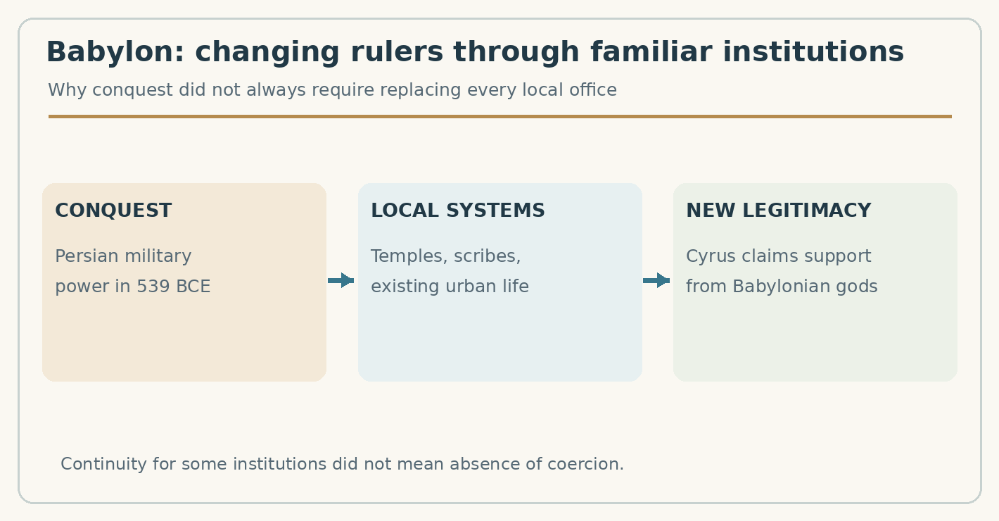

Babylon had been the center of an important Mesopotamian empire and remained a city whose religious traditions carried extraordinary prestige. Cyrus's forces defeated Babylonian military resistance in 539 BCE, and the city came under Persian rule. Contemporary Babylonian sources, including the <em>Nabonidus Chronicle</em> and the <em>Cyrus Cylinder</em>, help us examine the transition from closer to the event than Herodotus's later narrative. Those documents do not agree on every detail with the most colorful Greek accounts.

The key historical insight is that Cyrus did not present himself only as a foreign conqueror. In a Babylonian setting, he could speak the traditional language of Mesopotamian kingship: legitimacy granted by Marduk, protection of temples, restoration of order and care for the city. This was an intelligent political translation. A ruler who wanted Babylonian cooperation had reason to make himself intelligible within Babylonian expectations. Persian identity did not prevent a king from using Babylonian political vocabulary.

What changed for ordinary people? For some scribes, the system of recording land, payments and obligations continued. For some temple communities, royal support may have been restored or reallocated. For the royal family and soldiers of the defeated government, conquest meant loss and danger. The available evidence is uneven; we should not imagine we can survey all Babylonian households. Still, the episode shows a general imperial technique: a king can claim to restore local order while redirecting ultimate authority to himself.

<figure class="figure" id="figure-15-3">

<figcaption>Figure 15.3. Persian conquest could coexist with continuity of local scribal and religious institutions. <a class="figure-anchor" href="#figure-15-3" aria-label="Link to this figure">#</a></figcaption>
</figure>
