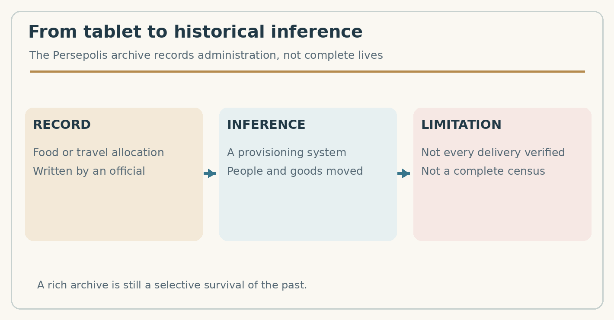

In the twentieth century excavators recovered tens of thousands of administrative tablets at Persepolis. The Persepolis Fortification Archive, primarily dating to Darius's reign, records aspects of food distributions, travel authorizations, officials, work groups and movement within the imperial heartland. Many documents are written in Elamite, not Old Persian. This is a reminder that a political empire and its daily paperwork can use different languages. Royal inscriptions tell us how a king wanted to be remembered; ordinary tablets show the organization needed to feed people and move resources.

The archive changes how we understand the economy. It records large administrative systems with ration scales and commodity transfers, not merely mysterious treasures stored in palaces. Some entries refer to women as recipients of provisions or as leaders of work groups, and some relate to childbirth. These details challenge the claim that the imperial economy was made entirely by men in military uniforms. But a tablet that assigns grain does not tell us everything about the recipient's freedom, happiness, household structure or legal status.

Imagine finding an entry authorizing grain for a group of workers. The secure observation is that an official recorded a specified allocation. With more documents we may infer a pattern of provisioning. To conclude that every worker received precisely the amount written, we would need corroboration; records can be incomplete, fraudulent, aspirational or limited to particular institutions. The Persepolis archive is enormously valuable precisely because it lets historians move from broad royal claims toward concrete systems—but it is still a fragment of the empire, not a census of everyone who lived within its borders.

<figure class="figure" id="figure-15-9">

<figcaption>Figure 15.9. A recorded allocation permits a targeted inference but not a complete biography of its recipient. <a class="figure-anchor" href="#figure-15-9" aria-label="Link to this figure">#</a></figcaption>
</figure>
