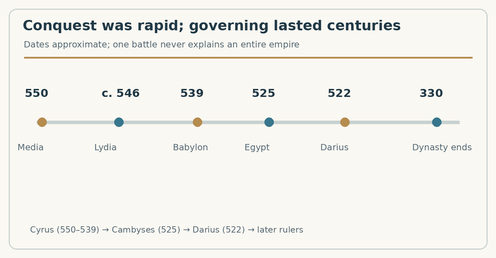

Cyrus II, remembered as Cyrus the Great, ruled Persia before 550 BCE and emerged as the architect of an expanding empire. Around 550 he defeated Astyages of Media, transforming a relationship between Iranian powers. In the 540s he brought Lydia into his control, extending Persian influence to the Aegean coast; the usual textbook date for Lydia's fall is 547/546 BCE, although the detailed sequence remains debated. In 539 BCE his forces conquered Babylonia. Within little more than a decade, the political map of western Asia had been remade.

That speed is striking, but a chronology of captured capitals hides much of the story. Cyrus needed alliances and experienced local administrators. Conquered elites might choose to cooperate because their estates and positions could survive under new management. Others could resist, and the empire used military force to defeat them. We cannot reconstruct every bargain. Later accounts, especially by the Greek historian Herodotus, interweave valuable traditions with dramatic conversations and memorable moral tales. The chronology has stronger documentary support than the precise words Cyrus supposedly spoke before a battle.

A state may expand quickly when its opponents are politically divided, when it inherits existing transport and tax systems, and when conquest brings resources that finance further conquests. That is a reinforcing process, as Chapter 7 explained. It also generates a balancing problem: newly conquered lands require troops, legitimacy and administration. Cyrus's ability to seize power across a broad area did not make the empire permanently secure. His successors would spend much of their energy governing—or recovering—what he had won.

<figure class="figure" id="figure-15-2">

<figcaption>Figure 15.2. Chronological anchors show rapid conquest and prolonged maintenance of imperial authority; dates are rounded. <a class="figure-anchor" href="#figure-15-2" aria-label="Link to this figure">#</a></figcaption>
</figure>
