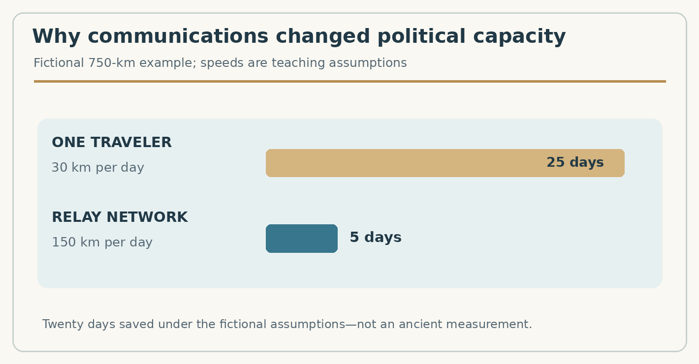

The Achaemenid world connected numerous existing routes and improved some important corridors. The famous 'Royal Road' is associated especially with the route between Sardis and the imperial heartland around Susa, although the empire used multiple roads, waterways and regional networks. Herodotus describes relay couriers and staging posts. We should not imagine an instant, perfectly uniform postal service across every village. The important innovation was a state-supported communication capacity operating through major routes and points of supply.

Picture a message moving 750 kilometers between two <strong>hypothetical</strong> administrative centers. A single traveler averaging 30 kilometers a day would require 25 days, ignoring interruptions. A relay network delivering messages at an average of 150 kilometers per day would carry the message in five days. These chosen speeds are merely a teaching calculation, not verified averages for the Persian court. The political difference is enormous: after receiving an order, a provincial governor might still have to gather men or supplies, but five days rather than twenty-five could allow a meaningful response before events changed.

Roads did more than carry commands. They helped merchants move goods, armies concentrate forces and officials supervise provincial networks. They also made extraction easier. An effective road could take grain toward a royal storehouse or transport soldiers toward a disobedient community. Infrastructure is rarely morally one-sided; it expands the capacity to act. The question becomes who controls that capacity and who pays for it.

<figure class="figure" id="figure-15-7">

<figcaption>Figure 15.7. A hypothetical comparison illustrates why relay networks changed government responsiveness. <a class="figure-anchor" href="#figure-15-7" aria-label="Link to this figure">#</a></figcaption>
</figure>
