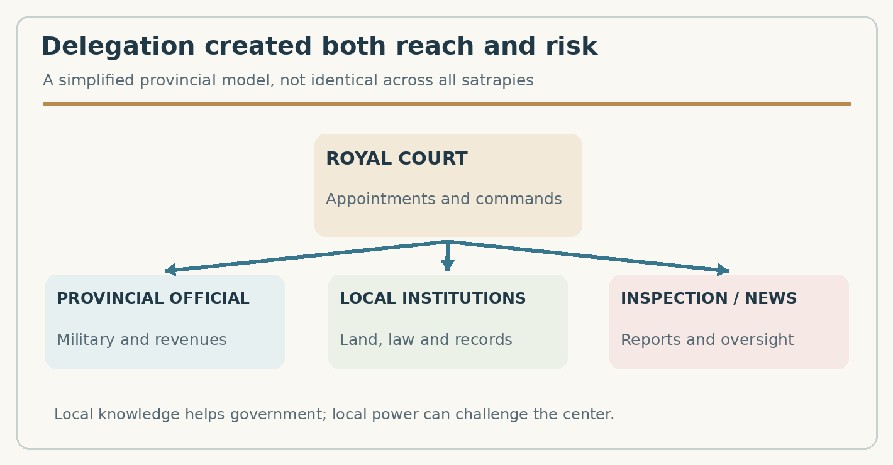

An empire of immense territories cannot be governed as if every decision comes directly from a single palace room. Achaemenid kings used provincial governors, commonly known through the Greek-derived term <em>satraps</em>, to manage territories. Officials oversaw taxation, military needs, communication, justice and relationships with local elites, although arrangements differed by period and province. Some positions were held by members of the royal family or influential Persian aristocratic households; many local institutions continued to function beneath them.

It is tempting to picture a neat map with identical provinces and identical rules. Ancient evidence supports a more uneven reality. Royal inscriptions list 'lands' or peoples for ideological purposes; Greek sources describe satrapies, and administrative documents reveal overlapping jurisdictions. A named province on a royal inscription is not necessarily the same thing as a fiscal district or the area directly commanded by one governor. Boundaries, obligations and titles changed. Some territories paid taxes; others furnished goods, troops or gifts under arrangements that were not always standardized.

The governing problem was a balance between <strong>local knowledge</strong> and <strong>central loyalty</strong>. A governor who understood local languages and landholding patterns could collect revenue more effectively. A governor who commanded too many troops or built strong local alliances might challenge the court. Royal inspectors, military commanders, treasurers, rival aristocrats and frequent communication offered the king ways to observe provincial affairs, but no oversight eliminated the risks of distance. Systems of delegation are not inherently weak: they are essential in large organizations. Their weakness emerges when incentives pull local officials away from central priorities.

<figure class="figure" id="figure-15-6">

<figcaption>Figure 15.6. Satraps and local officials extended royal control while creating problems of oversight and loyalty. <a class="figure-anchor" href="#figure-15-6" aria-label="Link to this figure">#</a></figcaption>
</figure>
