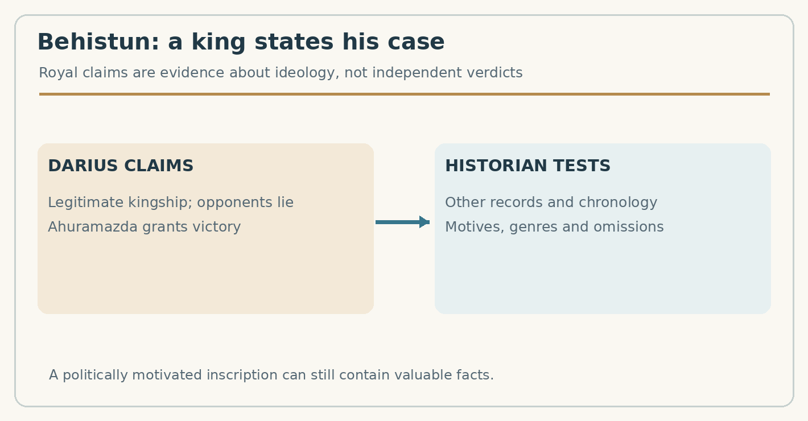

After Cambyses's death in 522 BCE, the empire entered a severe political crisis. Darius I took the throne, and rebellions broke out in several regions. His great inscription at Behistun (also written Bisotun), carved on a cliff in western Iran, tells a highly organized story: a fraudulent usurper had seized the throne, Darius destroyed the impostor, divine favor supported him, and he defeated a series of rebels who lied about their legitimacy. The text appears in Old Persian, Elamite and Babylonian, making the monument important both as political propaganda and for the later decipherment of cuneiform.

The inscription is direct evidence that Darius wanted his claims remembered in a particular way. It is not independent proof that every rival was fraudulent, nor that the dispute over the throne unfolded exactly as he reported. A ruler who emerged from contested succession had powerful incentives to define opponents as 'liars' and himself as the agent of order. That does not make the inscription useless. It tells us names, campaigns, royal ideology and the carefully staged structure of the new king's justification, which can be tested against other sources.

For historical reasoning, compare Darius's monument with the Cyrus Cylinder. Both communicate with local traditions, both justify the new ruler, and both are selective. The Cylinder speaks in Babylonian religious-political language after conquest; Behistun stresses Darius's legitimacy and the punishment of rebellion after civil conflict. They are different genres serving related political goals. Recognizing an interest behind a source means asking sharper questions, not automatically reversing every assertion.

<figure class="figure" id="figure-15-5">

<figcaption>Figure 15.5. Darius shaped the story of his accession; the inscription requires critical corroboration. <a class="figure-anchor" href="#figure-15-5" aria-label="Link to this figure">#</a></figcaption>
</figure>
