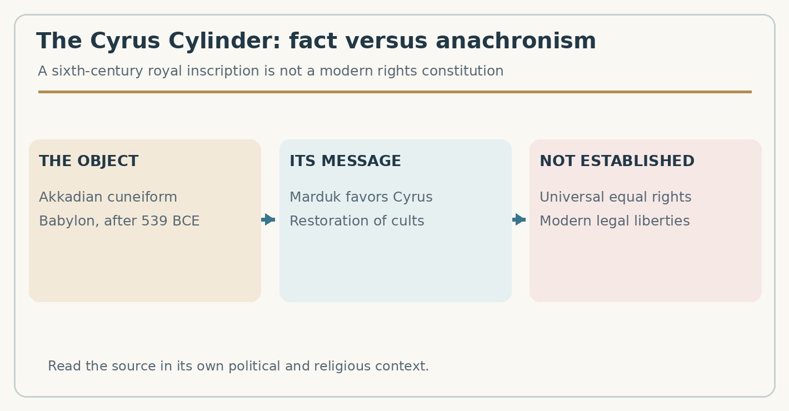

The Cyrus Cylinder is a clay object inscribed in Babylonian Akkadian cuneiform after Cyrus's conquest. Its text presents Cyrus favorably, attacks the legitimacy of the previous ruler Nabonidus and links the new king to the god Marduk. It describes the restoration of cultic arrangements and the return of displaced divine images or communities in language appropriate to Mesopotamian royal inscriptions. Because it was deposited in a foundation context, it was not designed as a modern public manifesto handed to every citizen.

In modern celebrations the Cylinder is sometimes called the first charter of human rights. That interpretation is appealing, especially to people seeking a hopeful ancient example of tolerance. But the document does not formulate equal individual rights, representative government, freedom of speech or a universal right to choose one's religion. Ancient royal legitimacy and modern legal rights are different political languages. The Cylinder can still provide important evidence about Cyrus's preferred image and certain policies; correcting the anachronism does not require dismissing its historical value.

Consider the distinction in three steps. <strong>Text:</strong> the king claims to have restored cultic order and to have been favored by Marduk. <strong>Inference:</strong> the new regime sought cooperation through familiar local religious institutions. <strong>Claim the text cannot support:</strong> the empire recognized every human being as the bearer of equal modern civil rights. This is exactly the reasoning method from Chapter 4: authenticate the source, identify its purpose, corroborate the event, and do not ask it to prove more than it can.

We should likewise be careful about associating a single royal document with every return movement mentioned in other traditions. The Hebrew Bible remembers Persian policy as important to the rebuilding of Jewish communal and religious life, particularly in Jerusalem. Those texts matter, but their composition, chronology and genres require historical analysis. Neither the Cylinder nor the biblical narratives should be treated as a transparent empire-wide policy manual.

<figure class="figure" id="figure-15-4">

<figcaption>Figure 15.4. The Cyrus Cylinder is an ancient legitimacy claim, not a charter of modern universal human rights. <a class="figure-anchor" href="#figure-15-4" aria-label="Link to this figure">#</a></figcaption>
</figure>
