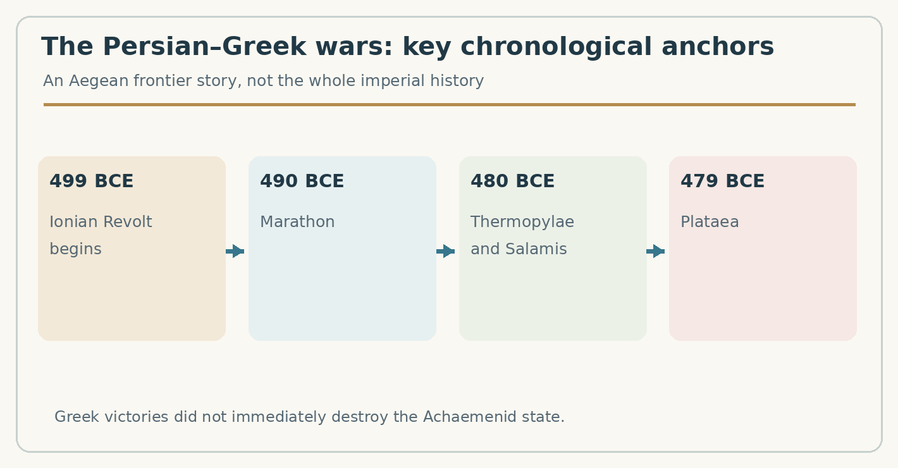

The conflict between Persia and Greek city-states is often narrated as though it were the central purpose of Achaemenid history. For the Persian court, the Aegean world was an important but limited part of an empire engaged simultaneously with many regions. The Ionian Revolt began in 499 BCE among Greek-speaking communities under Persian domination in Anatolia, with involvement from mainland Greek states. Darius's campaign against Athens culminated in the Persian defeat at Marathon in 490 BCE. Under Xerxes, a major invasion in 480 BCE included the battles of Thermopylae and the naval Battle of Salamis; Greek allied victory at Plataea in 479 BCE helped end the mainland invasion.

These dates are useful anchors, but they cannot substitute for explanation. Greek poleis were politically divided, and some cooperated with Persia. Persian commanders and soldiers were not a single unthinking mass. The outcome reflected geography, naval organization, alliances, logistics, strategy and political choices on both sides. The popular binary 'free Greeks versus enslaved Persians' hides differences among Greek constitutions and the diverse experiences of Persian imperial subjects. The Greeks' eventual success in defending much of their mainland did not destroy the Persian Empire.

Herodotus is indispensable for many episodes but wrote from within a Greek literary and political world. Aeschylus's tragedy <em>The Persians</em> offers another Greek perspective, sophisticated and humane in places yet not a Persian court archive. We should read those authors alongside Persian inscriptions, archaeology and the administrative record, noting that the evidence is very different for battlefield speeches and long-term provincial taxation. A Greek victory can be true, and a Greek interpretation of the enemy's motives can still be disputed.

<figure class="figure" id="figure-15-10">

<figcaption>Figure 15.10. The Persian–Greek conflicts were a frontier episode in a much longer imperial history. <a class="figure-anchor" href="#figure-15-10" aria-label="Link to this figure">#</a></figcaption>
</figure>
