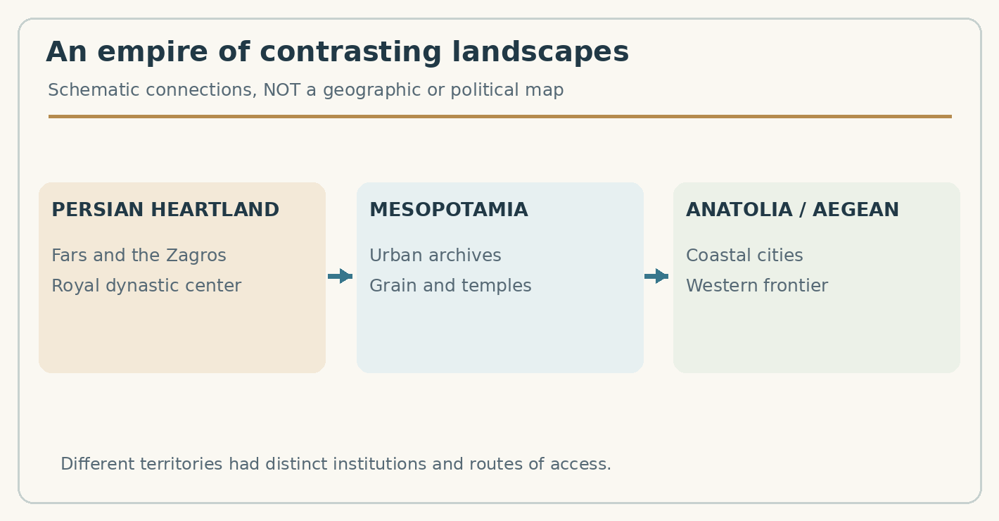

The ancient Persians emerged within a large and uneven Iranian world. The Zagros Mountains, Iranian plateau, valleys around ancient Elam, and arid landscapes to the east created a patchwork of routes and settlements. Southwest of the highlands, the district the Persians called Parsa, broadly the region of modern Fars in Iran, offered both a political heartland and links to older cities. To the northwest lay Media; to the west Mesopotamia; to the north and east varied highland and steppe communities. The Persian state's geography was therefore not an isolated desert fortress. It was a crossroads between agricultural regions, pastoral peoples and major imperial predecessors.

A mountain chain can shelter communities from an army, but it also channels armies toward passes. A desert can discourage casual travel, yet caravans using known wells can cross it. The distance between the Iranian interior and Babylon matters because messages, soldiers and provisions had to cross it repeatedly. We should resist a familiar mistake from Chapter 5: mountains do not automatically produce hardy warriors, and rivers do not automatically produce empires. Human institutions decide how to use the opportunities a landscape offers.

The name 'Persia' is convenient for this dynasty, but it should not flatten every community of the region into a single ethnicity or language. Medes, Persians, Elamites, Babylonians and many other peoples maintained varied identities. Modern Iran's borders are not the borders of the ancient empire, and the later history of Iranian peoples is much longer than the Achaemenid period, conventionally dated about 550–330 BCE. The term <em>Achaemenid</em> identifies a royal dynasty and its political order, not every period in Persian history.

<figure class="figure" id="figure-15-1">

<figcaption>Figure 15.1. The early Persian heartland connected several ecological and political worlds; the diagram is not a territorial map. <a class="figure-anchor" href="#figure-15-1" aria-label="Link to this figure">#</a></figcaption>
</figure>
