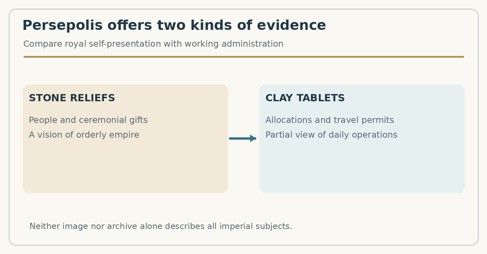

Many empires are introduced as though they possess one capital, a single building from which every command radiates. Achaemenid kings had multiple royal centers with overlapping ceremonial, residential and administrative functions. Pasargadae, founded under Cyrus in the Persian heartland, commemorated dynastic beginnings. Susa was an important older Elamite city developed as a royal residence. Babylon retained its economic and symbolic importance. Persepolis, founded under Darius near the end of the sixth century BCE, expressed the grandeur and order of kingship on a monumental terrace.

Persepolis is especially memorable for reliefs showing representatives of diverse lands, carefully rendered garments and animals, procession scenes, columns and immense gates. These images were not photographs of a specific tax delivery. They constructed a vision of hierarchy: many peoples organized peacefully around the king. The art offers evidence of imperial self-presentation and perhaps aspects of court ceremony, but we should not infer that all provinces willingly accepted equal relations with the crown. Images of harmony can coexist with histories of resistance.

Several royal centers were an advantage in a geographically diverse empire. The court could remain connected to different provinces and traditions, and existing urban systems remained useful. The costs were real: large households, craftspeople, food supplies, animals, officials and archives had to move or be maintained at various sites. The king was not only an individual ruler but the center of a traveling institution that required extraordinary organizational capacity.

<figure class="figure" id="figure-15-8">

<figcaption>Figure 15.8. Monumental royal imagery and practical administrative tablets illuminate different aspects of imperial rule. <a class="figure-anchor" href="#figure-15-8" aria-label="Link to this figure">#</a></figcaption>
</figure>
