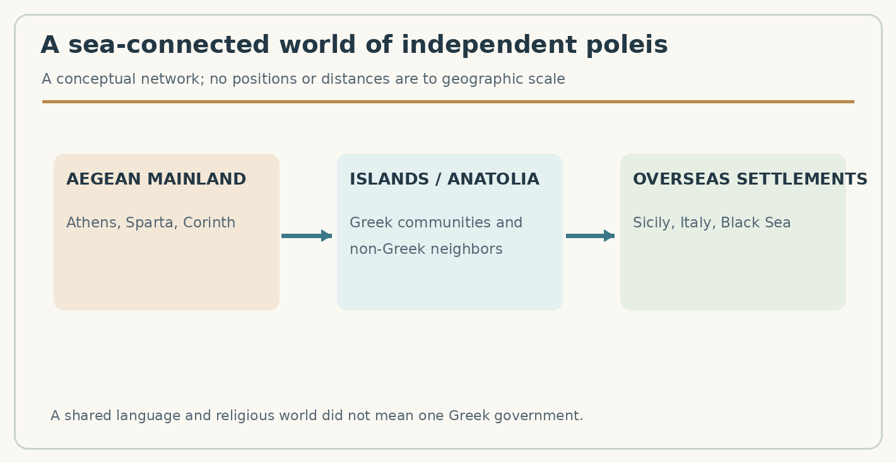

Geography enters this story, but it is not destiny. The southern Balkan peninsula is divided by mountain ranges, narrow valleys and coastlines with many natural harbors. Across the Aegean lie islands and the western shores of Anatolia. Sailors could connect communities separated by water more readily than some neighboring inland settlements could cross rough terrain. The Mediterranean and Black seas were highways of migration, commerce, piracy, warfare and cultural exchange. Greek-speaking settlements eventually occupied places as far apart as southern Italy, Sicily, North Africa and the Black Sea littoral.

The people we call ancient Greeks used languages and dialects related to one another, honored overlapping gods, and developed institutions that could make them recognize shared customs. Yet there was no single enduring Greek government during the Archaic and Classical periods. A Greek <em>polis</em> was not a miniature nation-state in the modern sense. It was a political community connected with a town, its countryside, households, cults, laws and recognized members. The territory around Athens, called Attica, included villages and farms far beyond its walls. Sparta governed an extensive territory in Laconia and Messenia. Other poleis were small enough that leading citizens knew one another personally.

Whenever a colored map labels the entire Aegean 'Greece,' ask which kind of claim it makes. Greek language, Greek cultural networks and Greek sovereignty were not identical. Borders shifted. A community might share a festival with neighboring Greeks while fighting them for farmland or allying with a foreign king. This repeated tension between cultural belonging and political independence made the Greek world inventive and unstable.

<figure class="figure" id="figure-16-1">

<figcaption>Figure 16.1. Greek cultural networks reached across the seas without producing one unified government. <a class="figure-anchor" href="#figure-16-1" aria-label="Link to this figure">#</a></figcaption>
</figure>
