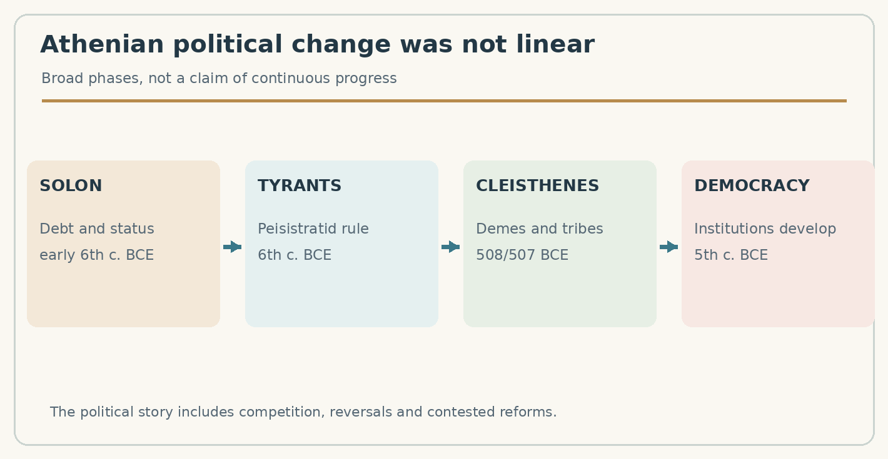

Around 508/507 BCE, <strong>Cleisthenes</strong> became associated with reforms that reorganized the Athenian citizen body. Citizens belonged to local districts called <em>demes</em> and were organized into ten new tribes drawing members from different regions of Attica. This disrupted some older regional and aristocratic alignments. A Council of Five Hundred, with fifty members associated with each tribe, provided a mechanism for preparing public business and coordinating state affairs. The reorganization did not suddenly solve every elite conflict, but it made the political community more closely tied to institutions and residence-based civic registration.

The language of <em>isonomia</em>, often rendered as equality before or under law, appears in the wider political vocabulary of the period. Its relationship to what we now label democracy is complicated; our surviving accounts were written after the events and can reflect later ideals. The important development is that political organization could make a citizen more than the dependent follower of a powerful household. Public offices and shared procedures gave new form to collective action.

Why were these institutional details important? Imagine a state in which every village is linked only through its nearest noble family. Such families may bargain as private blocs. Now imagine regional groups deliberately mixed within a civic council. The reform does not eliminate inequality but can produce new networks of obligation and information. Geography is being transformed into politics. The lessons from Chapter 7 apply here: reorganizing a system's membership can alter incentives even without changing every individual's beliefs.

<figure class="figure" id="figure-16-4">

<figcaption>Figure 16.4. Athenian institutions changed through conflict, reform and periods of concentrated rule. <a class="figure-anchor" href="#figure-16-4" aria-label="Link to this figure">#</a></figcaption>
</figure>
