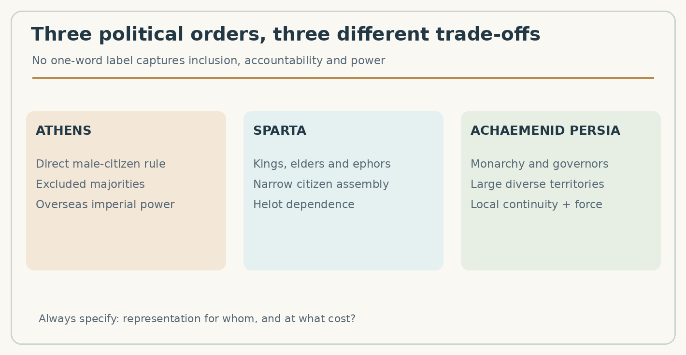

Put three political orders side by side. <strong>Athens</strong> experimented with broad direct participation among adult male citizens, rotation by lot and public argument, but excluded much of its population and ruled an overseas empire. <strong>Sparta</strong> distributed authority among kings, ephors, elders and an assembly of citizens, while concentrating full political membership in a small body supported by helot labor. The <strong>Achaemenid Empire</strong>, from Chapter 15, ruled enormous territories through monarchy, provincial intermediaries, administrative continuity and military power; it permitted forms of local diversity without giving subjects equal control over imperial decisions.

Which system was best? The answer depends on the criterion: citizens' opportunity to participate, security from violence, treatment of excluded populations, capacity to coordinate resources, stability over time or protection from an arbitrary ruler. We cannot reduce those dimensions to a single moral scoreboard. Direct participation does not automatically secure individual rights; multiple offices do not automatically include the majority; tolerant local administration does not make an empire democratic. Historical comparison becomes useful when we state precisely which institutional feature and outcome we are comparing.

Try one further comparison with the present. A modern parliamentary democracy usually relies on elected representatives, broad adult suffrage, professional administration and rights protected through constitutions or law. Classical Athens did not have that exact package. Using the word <em>democracy</em> for both can be illuminating, provided we say what changed: the boundaries of citizenship, modes of representation, scale, participation, and legal protections. The Greeks gave us enduring political questions, not a completed operating manual.

<figure class="figure" id="figure-16-12">

<figcaption>Figure 16.12. Different ancient political orders had different institutions and different exclusions. <a class="figure-anchor" href="#figure-16-12" aria-label="Link to this figure">#</a></figcaption>
</figure>
