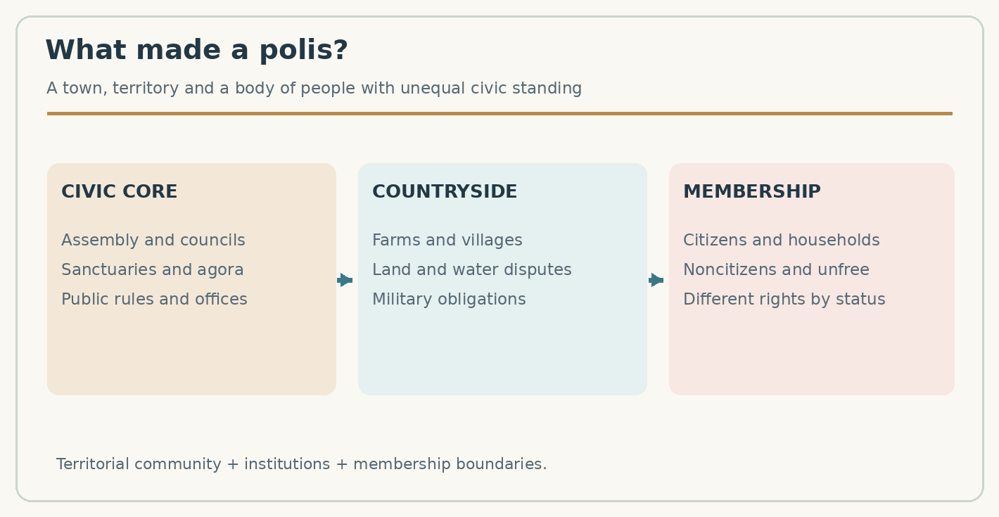

Between roughly the ninth and seventh centuries BCE, many Greek communities underwent population growth, changes in agricultural organization, expanding exchange and new forms of public life. Temples and sanctuaries became focal points. Communities built walls, defined territories, developed councils, and began to record rules. The <em>agora</em> could serve as a market and civic gathering place; an <em>acropolis</em> might be a defensible height or a sacred center. The particular arrangement differed from polis to polis.

Why would people accept a common political order rather than rely entirely on powerful families? A polis could organize defense, settle disputes, manage shared cults, allocate land, and coordinate relationships with outsiders. Rules could restrain arbitrary decisions—although who made the rules remained contested. A town might have aristocratic magistrates, a council of elders, a broader assembly, or an exceptional ruler. Political change was often driven by struggles over land, debt, inheritance, military service and the social standing of prosperous households outside the oldest elite families.

The polis was simultaneously a space for collective identity and a boundary-making institution. Its citizens might possess legal protections and a recognized voice denied to noncitizens. An argument that law should apply to fellow citizens could coexist with the exploitation of captive labor. This dual character will appear repeatedly: political inclusion for one group can be built upon exclusion of another.

<figure class="figure" id="figure-16-2">

<figcaption>Figure 16.2. A polis combined civic spaces, countryside and unequal categories of membership. <a class="figure-anchor" href="#figure-16-2" aria-label="Link to this figure">#</a></figcaption>
</figure>
