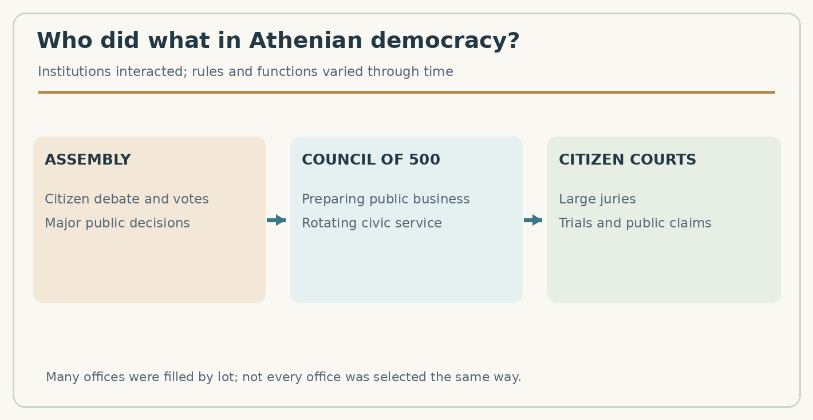

By the fifth century BCE, Athens had developed a distinctive form of <strong>direct citizen participation</strong>. The <em>ekklesia</em>, or Assembly, brought eligible male citizens together to debate and vote on important business: war and peace, policy, decrees and some public decisions. The <strong>Council of Five Hundred</strong> prepared business, while a large network of magistrates performed administrative roles. Many offices and juries were filled by lot among eligible citizens, though elected offices existed, especially those requiring military expertise. Procedures evolved over time, and participation depended on age, status, location and practical ability to attend.

Selecting officeholders by lot rested on an idea different from modern competitive elections: ordinary citizens, rather than a permanent class of political professionals, should rotate through certain public duties. Elections could favor wealth, reputation or powerful families; lotteries helped broaden participation among the citizens who qualified. But random selection does not supply expertise automatically. Institutions therefore used term limits, scrutiny and accountability procedures. One feature of the system—the possibility that a relatively ordinary citizen could serve on a council or jury—was striking in antiquity.

Athenian courts often used large citizen juries without a modern professional judge deciding facts in the same way as many present-day courts. Litigants delivered speeches that could appeal to laws, character, emotion and political loyalties. Our surviving court speeches are valuable evidence for social life, but they are crafted arguments by interested speakers. The Assembly likewise was not an ideal classroom in which the best evidence always won. Strong rhetoric, urgency, group pressure and strategic misinformation could shape decisions.

<figure class="figure" id="figure-16-5">

<figcaption>Figure 16.5. The citizen Assembly, Council and courts performed different functions in the Athenian democracy. <a class="figure-anchor" href="#figure-16-5" aria-label="Link to this figure">#</a></figcaption>
</figure>
