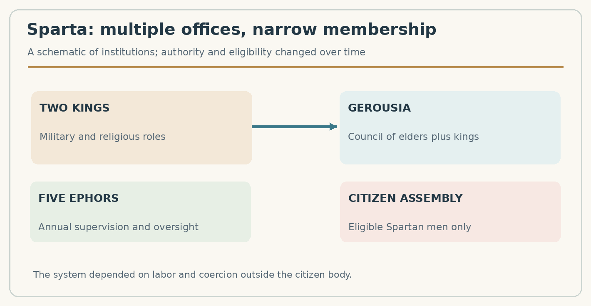

Sparta traditionally had <strong>two kings</strong> from separate royal houses, associated particularly with command in war and religious duties. But the kings did not govern alone. A council of elders, the <em>gerousia</em>, included older men and the kings; five annually selected <strong>ephors</strong> exercised important supervisory powers; and an assembly of eligible male citizens could participate in public decisions, though its power and procedures were more constrained than in democratic Athens. The exact balance changed across time and is reconstructed from sources written in different circumstances.

In Sparta, formal stability rested on multiple offices and customary expectations, not a simple modern constitutional separation of powers. The two kings could check one another but also compete. The ephors could hold leaders accountable, yet the small citizen body and dependence on helot labor limited the system's broader legitimacy. A state can contain internal checks without being democratic in the modern or Athenian sense.

A further complication is how much our picture comes from outsiders. Xenophon admired many Spartan practices; Aristotle criticized parts of its institutions; Plutarch, writing centuries later, preserved stories about the legendary lawgiver Lycurgus. Archaeology and inscriptions provide additional evidence, but some familiar details of Spartan upbringing or laws remain contested. Instead of memorizing a perfectly fixed 'Spartan constitution,' the careful reader asks which period and which source a claim concerns.

<figure class="figure" id="figure-16-3">

<figcaption>Figure 16.3. Spartan authority was divided among multiple institutions but full political citizenship was narrow. <a class="figure-anchor" href="#figure-16-3" aria-label="Link to this figure">#</a></figcaption>
</figure>
