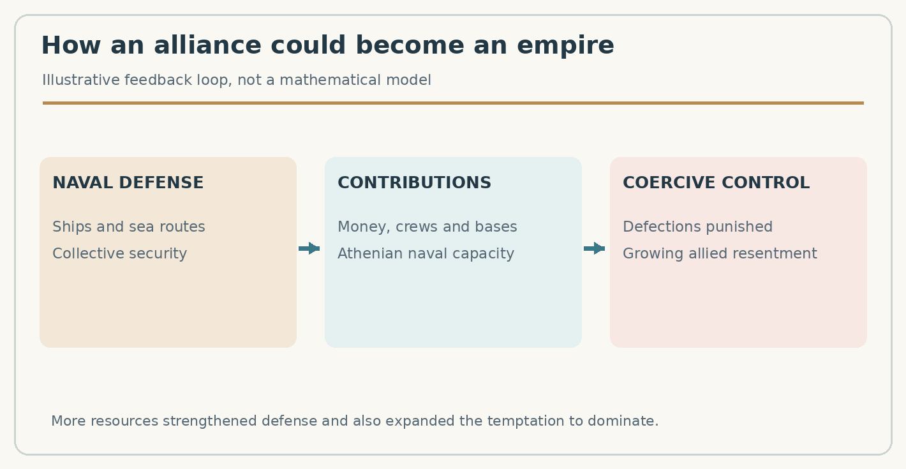

Following the Persian Wars, a league of Greek communities led by Athens coordinated naval action and the collection of contributions. Its treasury was initially associated with the sacred island of Delos, giving rise to the name <strong>Delian League</strong>. Members supplied ships or money, in arrangements that changed over time. For cities vulnerable to Persian attack, collective defense had obvious advantages. For Athens, the league increased ships, financial resources and political authority.

Over time Athens became increasingly willing to use force to prevent allied defections and enforce contributions. Some allies experienced 'protection' as domination. The transfer of the league treasury to Athens in 454 BCE symbolized and facilitated a changing relationship, although the precise motives and mechanisms are debated. The growth of an empire from an alliance is not merely a moral contradiction; it is a systems problem. A naval power needs stable funding and bases to defend maritime routes; the act of securing those resources can make reluctant partners dependent and angry.

Greek history therefore shows an uncomfortable coexistence: the same city that pioneered extraordinary citizen participation at home compelled obedience abroad. A citizen sailor might see his wages and civic power supported by naval revenue while an allied community saw taxes, forced political alignment or punishment for resistance. If one praises democracy without examining empire, one misses a fundamental feature of the Athenian experience.

<figure class="figure" id="figure-16-8">

<figcaption>Figure 16.8. Allied contributions strengthened the fleet while also creating the capacity for coercion. <a class="figure-anchor" href="#figure-16-8" aria-label="Link to this figure">#</a></figcaption>
</figure>
