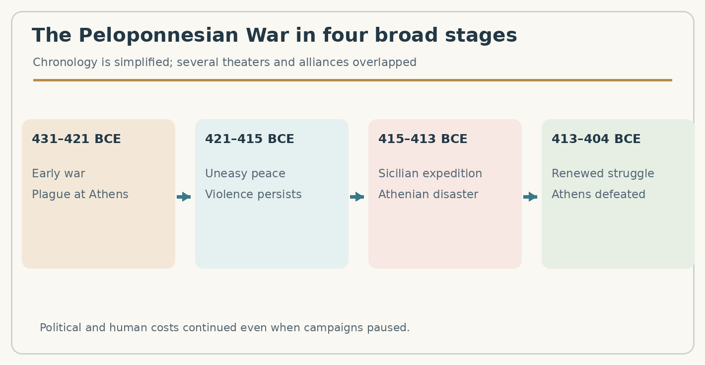

The <strong>Peloponnesian War</strong> conventionally ran from 431 to 404 BCE, with phases of open fighting interrupted by fragile peaces and renewed campaigns. Athens led a maritime empire and commanded a formidable fleet; Sparta was a dominant land power with a network of allies, often called the Peloponnesian League. Thucydides famously emphasized fear caused by Athens' growing power as a fundamental source of the conflict, but particular disputes involving Corcyra, Corinth and Potidaea also mattered. We should not mistake one elegant explanation for the only cause.

Early in the war, the Athenians adopted a strategy associated with Pericles: avoid confronting superior Spartan land forces in a decisive battle, shelter people within the walls, and rely on sea power and imports. The strategy protected military strength but crowded the city. A devastating <strong>epidemic</strong> struck Athens beginning in 430 BCE, killing many residents and Pericles himself in 429. Its precise disease identity remains debated. The epidemic was a public-health disaster inside an ongoing war; neither a moral punishment nor a plot required by the evidence.

Conflict affected farmers whose fields were ruined, enslaved people whose lives were already precarious, allies compelled to send resources, soldiers and families confronted with death and displacement. Histories built around battles can erase this slow destruction of communities. War also altered political incentives: leaders could win applause for aggressive promises, factions accused rivals of disloyalty, and prolonged uncertainty made moderate compromise difficult. The chapter's systems framework helps us see escalating mistrust without pretending every actor was equally responsible for every decision.

<figure class="figure" id="figure-16-9">

<figcaption>Figure 16.9. The Peloponnesian War included changing phases and repeated political disruption. <a class="figure-anchor" href="#figure-16-9" aria-label="Link to this figure">#</a></figcaption>
</figure>
