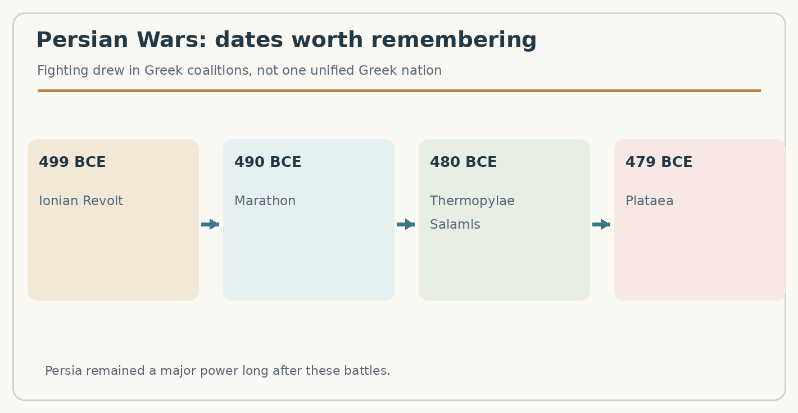

The story of Persia and the Greek cities connects directly to Chapter 15. Some Greek communities of western Anatolia lived within the Achaemenid Empire. The <strong>Ionian Revolt</strong> began in 499 BCE, drawing Persian responses and limited mainland Greek intervention. In 490 BCE an Athenian force, with assistance from Plataea, defeated a Persian expedition at <strong>Marathon</strong>. In 480 BCE Xerxes led a much larger invasion; famous battles included <strong>Thermopylae</strong> and the naval engagement at <strong>Salamis</strong>. A coalition of Greek forces defeated major Persian forces at <strong>Plataea</strong> in 479 BCE.

These events were momentous, but the common story of 'united Greeks defending liberty against enslaved Persia' is misleading. Numerous Greek communities remained neutral, joined the Persian side or made choices under pressure. Greek poleis disagreed with one another before, during and after the invasion. The Persian Empire endured long afterward; Greece did not become one free and harmonious nation. The battles were part of a wider imperial and Aegean history, not a single decisive contest between modern political ideologies.

What made cooperation possible despite rivalry? Immediate military threats can change incentives. Greek communities could pool forces while retaining separate governments. Sparta's land military strength and Athens' naval force contributed in different ways. Themistocles' support for Athenian naval power is an important part of the story, although later authors shape the image of this leader differently. Geography mattered to strategy—straits, harbors and supply lines—but no geographical feature predetermined the outcome.

<figure class="figure" id="figure-16-7">

<figcaption>Figure 16.7. Major military anchors of the Persian Wars; Greek alliances were not political unification. <a class="figure-anchor" href="#figure-16-7" aria-label="Link to this figure">#</a></figcaption>
</figure>
