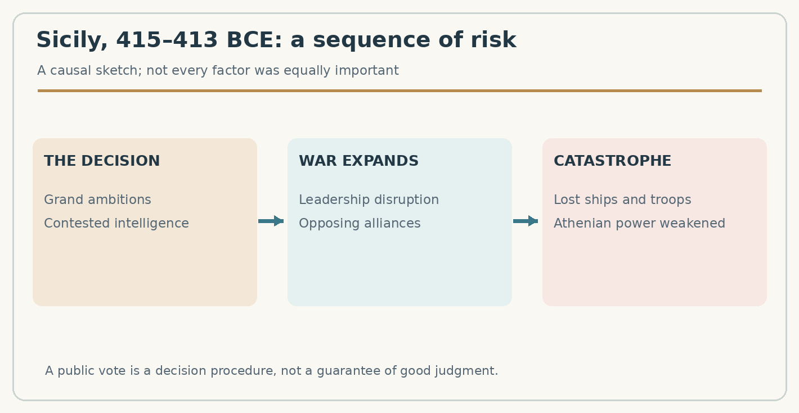

Return to the debate from the opening. In 415 BCE Athens launched a major expedition to <strong>Sicily</strong>, partly connected with rivalries involving Segesta and Syracuse and partly shaped by broader hopes of increasing power. The expedition was controversial. Thucydides presents Nicias warning about the undertaking and Alcibiades arguing for it, but we should treat the speeches as reconstructed arguments rather than complete transcripts.

The operation grew far beyond a limited intervention. Political scandal at home affected leadership; Alcibiades defected after being recalled to face accusations. In Sicily, Athens encountered severe logistical, diplomatic and tactical difficulties. Syracuse obtained support from Sparta and other opponents. Athenian reinforcement did not rescue the situation. By 413 BCE the expedition had ended with the destruction or capture of much of the force, a costly blow to Athens' naval and manpower resources.

Why did an assembly capable of vigorous debate produce such a disastrous outcome? The question has no single answer. Hope of expansion, overconfidence, inadequate knowledge of local conditions, the desire not to appear weak, strategic rivalries and shifting leadership all contributed. A decision can be made democratically and still be poorly informed. The correct historical lesson is not that mass participation always fails; an unelected ruler might make the same error. The lesson is that <strong>decision procedures and decision quality are different dimensions</strong>. Risk assessment, access to dissent and the ability to revise plans matter in any regime.

<figure class="figure" id="figure-16-10">

<figcaption>Figure 16.10. A schematic of decisions and consequences, not a complete causal explanation of defeat. <a class="figure-anchor" href="#figure-16-10" aria-label="Link to this figure">#</a></figcaption>
</figure>
