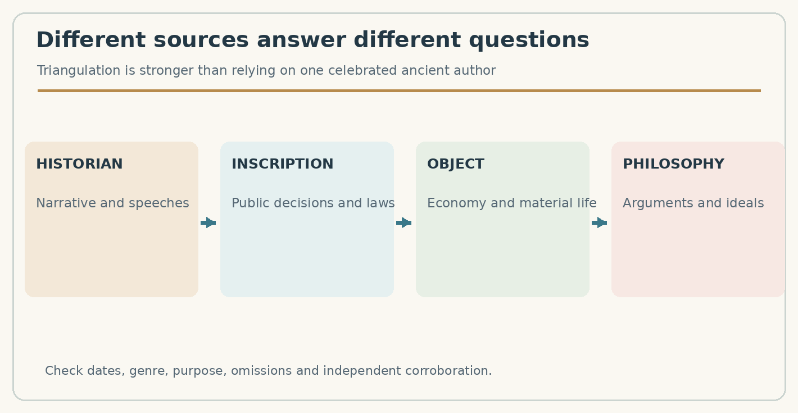

How might we reconstruct a disputed Athenian decision? Suppose a student claims: 'The Assembly always listened to both sides and therefore made rational decisions.' First examine an account such as Thucydides' Sicilian debate. It shows competing arguments, but the historian composed the speeches and selected the episode. Second consider an inscription or decree that records an official decision. That can establish aspects of what was enacted, but it may not disclose all the discussion, attendance or motives. Third examine archaeology: ships, harbor infrastructure, military graves, coins and other material can reveal resources and consequences, but it cannot prove a speaker's private beliefs.

Now reverse the claim: 'Athenian democracy was nothing but mob rule.' That also exceeds the evidence. The Athenians developed structured assemblies, councils, accountability procedures, public payment for service and large citizen juries. We have examples of both prudent and destructive decisions. A historian should test the claims one by one, distinguish procedures from outcomes and specify the time period being studied. Athenians themselves argued about whether the many or the few were best qualified to govern.

Every source tells a different part of the story. An engraved law may show an official principle without proving compliance. A comedy may capture anxieties while exaggerating personalities. A hostile oligarchic pamphlet can reveal elite fears even when its attacks are unfair. A philosophical dialogue may illuminate the questions of its author's age without accurately describing a real conversation. Source criticism is not a ritual of saying 'everything is biased.' It is a discipline of making the strongest defensible inference from each kind of surviving evidence.

<figure class="figure" id="figure-16-11">

<figcaption>Figure 16.11. Historians compare literary accounts, official records, objects and philosophical arguments. <a class="figure-anchor" href="#figure-16-11" aria-label="Link to this figure">#</a></figcaption>
</figure>
