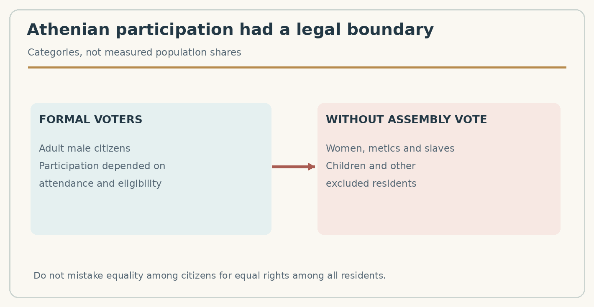

The phrase 'Athens invented democracy' requires a sentence of qualification. Participation in its governing institutions was restricted chiefly to <strong>adult male citizens</strong>. Women of citizen families did not vote in the Assembly or serve in the major political offices of the democracy. Resident foreigners, commonly called <em>metics</em> in the Classical context, worked, traded, paid taxes and sometimes performed military duties but did not generally enjoy citizen voting rights. Enslaved people had no political freedom comparable to citizens. Children were likewise excluded from adult political institutions.

Citizenship rules could become more restrictive. Pericles' citizenship law of 451/450 BCE, commonly understood to have required two citizen parents for full citizen status, is an example of a political community narrowing membership while increasing the power of those inside it. Estimates of the ratio between citizens and the total population of Attica vary sharply, because the evidence is incomplete and categories changed over time. A diagram that claims an exact share of all residents were voters would imply false certainty. What is secure is that the politically empowered adult male citizen group was a minority of the larger population.

The contradiction matters. Athens developed mechanisms of civic equality <strong>within the citizen group</strong> while resting economically and socially on unequal relationships beyond it. To learn from the institutional achievements without romanticizing the exclusions, ask two questions separately: how much power did an eligible citizen have in comparison with citizens elsewhere, and who was denied that eligibility? The distinction is essential for comparing ancient democracy with modern constitutional systems, where broad adult suffrage and individual rights are central aspirations.

<figure class="figure" id="figure-16-6">

<figcaption>Figure 16.6. The political power of male citizens coexisted with the exclusion of many residents. <a class="figure-anchor" href="#figure-16-6" aria-label="Link to this figure">#</a></figcaption>
</figure>
