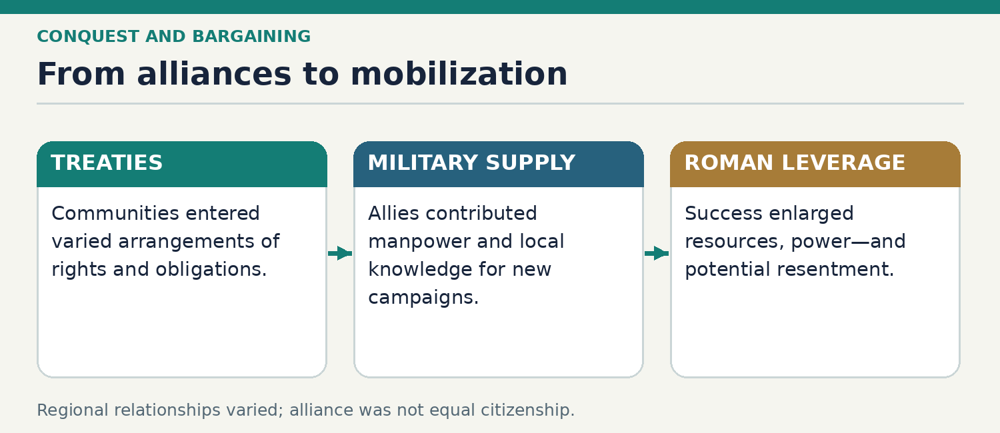

Rome did not conquer all Italy in one campaign. Its wars against Latin neighbors, Etruscan communities, Samnites and Greek cities extended over generations. Defeated or allied communities entered different arrangements: some gained citizenship, others partial rights, others treaties requiring military assistance. Roads, colonies and fortifications helped project Roman power. The resulting network could mobilize manpower on a scale that gave Rome a remarkable capacity to recover from military defeats.

This system combined incentives and coercion. An allied community might benefit from Roman support and access to networks while also losing freedom in foreign policy and contributing soldiers to wars it had not chosen. Roman colonies could secure territory and settle citizens, but they also affected previous inhabitants. Citizenship became a powerful instrument of integration precisely because it was desirable and unequally distributed.

In 280–275 BCE, Pyrrhus of Epirus campaigned in Italy in support of Greek cities. He won battles at heavy cost but did not establish durable supremacy. His wars reveal Rome's arrival as a major Italian power and the connection between Italian conflicts and the Hellenistic kingdoms created after Alexander. The expression 'Pyrrhic victory' captures the difference between winning a battle and achieving a sustainable political objective. <strong>Rome's greatest early military asset may have been its alliance network, not one decisive weapon or invincible general.</strong>

<figure class="figure" id="figure-17-3">

<figcaption>Figure 17.3. Treaties and military obligations produced a network capable of extraordinary mobilization. <a class="figure-anchor" href="#figure-17-3" aria-label="Link to this figure">#</a></figcaption>
</figure>
