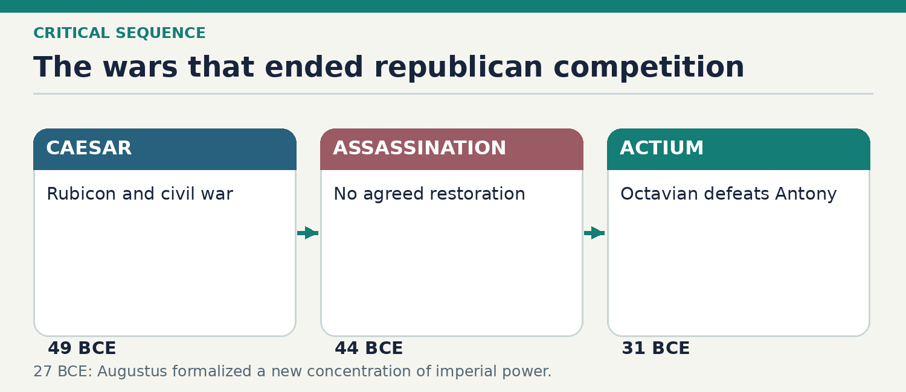

Julius Caesar's career illustrates the difficulty of separating lawful office from extraordinary power. In 60 BCE he entered an informal political alliance with Pompey and Crassus, later known as the <strong>First Triumvirate</strong>. It was not a constitutional three-man executive. Caesar subsequently commanded major campaigns in Gaul, whose conquest expanded Roman power and caused extensive death, enslavement and displacement. His own account of the campaigns is an essential but self-interested source; victories narrated by the victorious commander require independent scrutiny.

Conflict with Pompey and other political rivals led Caesar to cross the Rubicon with troops in 49 BCE, initiating another civil war. After victory he accumulated exceptional offices and honors, culminating in a dictatorship for life. In March 44 BCE, a group of senators assassinated him. The conspirators spoke the language of freedom, yet they had no widely accepted plan for settling the claims of Caesar's army, his supporters and the wider citizen body. Killing a leader did not dissolve the system of incentives that produced him.

Caesar's heir Octavian, later Augustus, allied with Mark Antony and Lepidus in a legally established <strong>Second Triumvirate</strong> in 43 BCE. Proscriptions and civil war followed. After the defeat of Caesar's killers at Philippi in 42 BCE, Octavian and Antony eventually became rivals. Antony's association with Cleopatra VII, queen of Egypt, was a major component of the political contest, but Roman propaganda made it into a story about foreign influence and Roman morality. Octavian defeated their forces at Actium in 31 BCE. Antony and Cleopatra died in 30 BCE, and Egypt came under Roman rule. The Republic survived in words and ceremonies, but one man now controlled the decisive armies.

<figure class="figure" id="figure-17-7">

<figcaption>Figure 17.7. Republican civil wars culminated in one-man rule disguised through traditional offices. <a class="figure-anchor" href="#figure-17-7" aria-label="Link to this figure">#</a></figcaption>
</figure>
