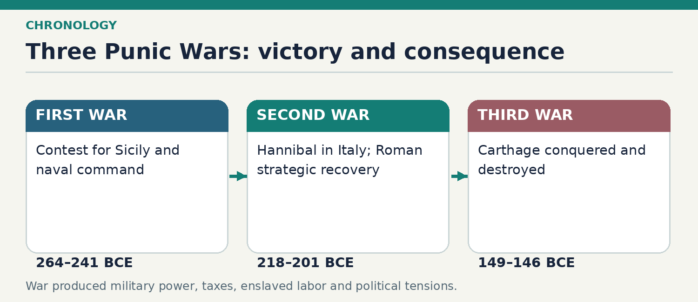

Carthage, founded by settlers from the Phoenician world in North Africa, became a sophisticated maritime and commercial power with interests in the western Mediterranean. Its rivalry with Rome developed into three major wars. In the <strong>First Punic War (264–241 BCE)</strong>, the principal struggle centered on Sicily; Rome developed the naval capabilities needed to challenge a major seaborne rival. The <strong>Second Punic War (218–201 BCE)</strong> saw Hannibal lead an army from Iberia over the Alps and inflict devastating defeats on Roman armies in Italy, notably at Cannae in 216 BCE. Roman resistance and campaigns beyond Italy helped reverse the strategic position. Scipio defeated Hannibal at Zama in 202 BCE.

A crucial lesson is that spectacular battlefield success does not necessarily translate into political victory. Hannibal could devastate Roman armies without persuading enough Italian allies to abandon their Roman connections. Rome could absorb losses through institutions, manpower and alliance commitments that survived disaster. Both states relied on diverse peoples and resources; reducing the war to two heroic commanders obscures that larger picture.

The <strong>Third Punic War (149–146 BCE)</strong> ended with Roman forces destroying Carthage as a rival political center. Modern myths sometimes describe Rome permanently salting its soil. Historians do not treat that as an established ancient practice. The conquest involved immense human suffering and enslavement. Rome emerged as an unrivaled western Mediterranean power, but its external victories intensified internal disputes over wealth, military labor and distribution of conquered resources. The Republic's success changed the environment in which republican political rules operated.

<figure class="figure" id="figure-17-5">

<figcaption>Figure 17.5. The three Punic Wars changed Mediterranean power and intensified Roman political tensions. <a class="figure-anchor" href="#figure-17-5" aria-label="Link to this figure">#</a></figcaption>
</figure>
