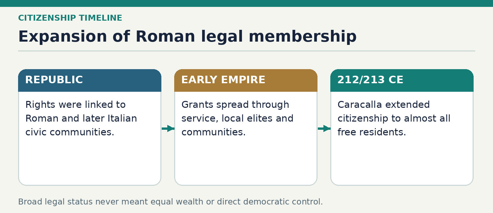

Roman citizenship began as a privileged legal and political belonging centered on Rome, then spread in different stages. The <strong>Social War (91–88 BCE)</strong> was driven in part by Italian allies' demands for citizenship and equal treatment within a state they helped defend. Rome ultimately extended citizenship across much of Italy. Later grants recognized service, elite status, local communities and imperial decisions. By the second century CE, the citizen body was dispersed across the provinces.

In <strong>212 or early 213 CE</strong>, the emperor Caracalla issued the <strong>Constitutio Antoniniana</strong>, generally understood to grant Roman citizenship to all or almost all free inhabitants of the empire who did not already have it. The surviving papyrus is damaged, and specific exceptions and motivations are debated. Citizenship did not abolish slavery, poverty, inequality or geographic division. Nor did everyone suddenly speak Latin or adopt identical customs. It changed legal status across a remarkable range of societies.

This case offers an important distinction between <strong>legal membership and actual influence</strong>. A provincial resident might become a Roman citizen without gaining an effective voice in choosing an emperor. Conversely, an influential local official without citizenship in an earlier period might exercise considerable practical power. When modern political arguments invoke 'Roman citizenship,' ask: which century, which rights, and for whom?

<figure class="figure" id="figure-17-10">

<figcaption>Figure 17.10. Roman citizenship expanded in stages, culminating in Caracalla’s broad grant to free inhabitants. <a class="figure-anchor" href="#figure-17-10" aria-label="Link to this figure">#</a></figcaption>
</figure>
