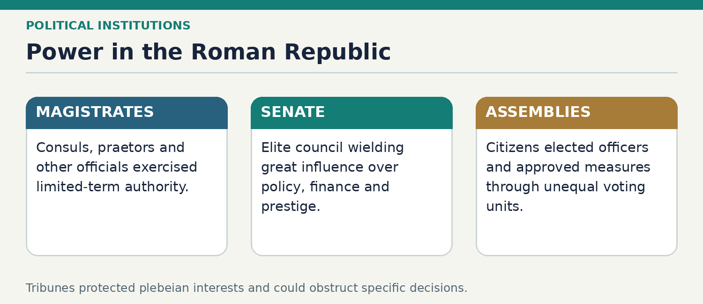

The <strong>Senate</strong> was a powerful deliberative council, not a modern elected upper house. Its membership came largely from men who had held magistracies. It supervised much of foreign policy, finance and political advice, exercising immense customary influence even when its formal resolutions were not equivalent to statutes in every setting. The <strong>consuls</strong> led armies and presided over central affairs. <strong>Praetors</strong> played important roles in legal administration. <strong>Quaestors</strong> handled financial responsibilities, while <strong>censors</strong>, elected periodically, assessed citizen lists and oversaw certain aspects of public status and behavior.

Popular assemblies elected magistrates and voted on legislation, but Roman voting was not one person, one equal vote. Assemblies grouped citizens by centuries or tribes, and the weight and order of voting could advantage wealthier citizens. Meetings were called and framed by officeholders. Citizens could express consent or rejection, but ordinarily did not draft laws through a permanent deliberative parliament. Travel costs and distance made physical participation harder as the citizen body expanded across Italy.

The political system therefore mixed <strong>aristocratic leadership, popular decision-making, legal tradition and military command</strong>. Some Romans celebrated this balance as a source of stability. The Greek historian Polybius, writing in the second century BCE, famously analyzed Roman institutions through a framework of mixed government. His account is illuminating, but it too reflects the standpoint of an observer impressed by Roman success. We should ask whether institutions that worked in a city of regional elites could govern a state extending across the Mediterranean.

<figure class="figure" id="figure-17-2">

<figcaption>Figure 17.2. Republican power involved magistrates, the Senate, assemblies and tribunes; no one institution governed alone. <a class="figure-anchor" href="#figure-17-2" aria-label="Link to this figure">#</a></figcaption>
</figure>
